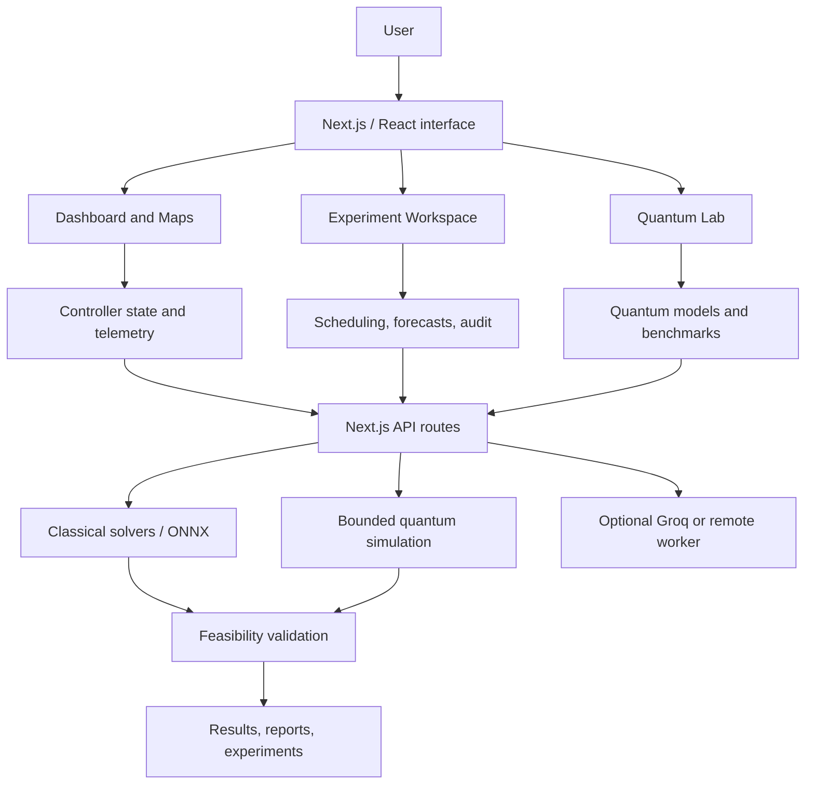
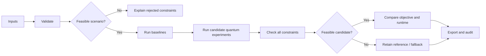
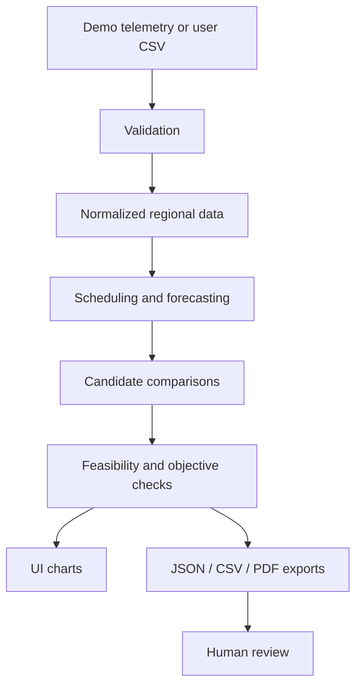

<div align="center">


# Carbon Ledger Quantum

**Carbon-aware cloud control · Quantum optimization research · Treasury analysis**

[**🌐 Live Website**](https://carbon-ledger-quantum.vercel.app/) · [**Dashboard**](https://carbon-ledger-quantum.vercel.app/dashboard) · [**Experiment Workspace**](https://carbon-ledger-quantum.vercel.app/experiments) · [**Quantum Lab**](https://carbon-ledger-quantum.vercel.app/quantum-lab)


</div>

> **Accuracy notice:** This is a research and demonstration platform. Synthetic telemetry, simulated quantum runs, forecasts, and modeled savings must not be represented as audited production results.

## Quick links — all topics

Every section below has a direct GitHub-compatible Markdown anchor. Click any subtopic to jump to it.

- [Project overview](#project-overview)
- [Problem statement](#problem-statement)
- [Solution at a glance](#solution-at-a-glance)
- [Core capabilities](#core-capabilities)
- [Technology stack](#technology-stack)
- [Architecture diagram](#architecture-diagram)
- [Decision flow diagram](#decision-flow-diagram)
- [Site navigation](#site-navigation)
- [Landing page](#landing-page)
- [Main controller dashboard](#main-controller-dashboard)
- [Dashboard internal tabs](#dashboard-internal-tabs)
- [Interactive 2D region atlas](#interactive-2d-region-atlas)
- [Interactive 3D globe](#interactive-3d-globe)
- [Crystal emerald interface](#crystal-emerald-interface)
- [Experiment Workspace overview](#experiment-workspace-overview)
- [Workloads tab](#workloads-tab)
- [Decisions tab](#decisions-tab)
- [Replay tab](#replay-tab)
- [Forecasts tab](#forecasts-tab)
- [Benchmarks tab](#benchmarks-tab)
- [Treasury tab](#treasury-tab)
- [Experiments tab](#experiments-tab)
- [Execution tab](#execution-tab)
- [Quantum Lab overview](#quantum-lab-overview)
- [QAOA fundamentals](#qaoa-fundamentals)
- [Digitized quantum annealing](#digitized-quantum-annealing)
- [QUBO and Ising inspection](#qubo-and-ising-inspection)
- [Quantum-enhanced forecast research](#quantum-enhanced-forecast-research)
- [Quantum surrogate model](#quantum-surrogate-model)
- [Quantum risk analysis](#quantum-risk-analysis)
- [Optimization objective and constraints](#optimization-objective-and-constraints)
- [Classical baseline fairness](#classical-baseline-fairness)
- [Benchmark metrics glossary](#benchmark-metrics-glossary)
- [Data provenance and realism](#data-provenance-and-realism)
- [Data lifecycle diagram](#data-lifecycle-diagram)
- [Installing Node.js](#installing-nodejs)
- [Local setup on Windows](#local-setup-on-windows)
- [Local setup on macOS or Linux](#local-setup-on-macos-or-linux)
- [Package scripts](#package-scripts)
- [Environment configuration](#environment-configuration)
- [Environment variable reference](#environment-variable-reference)
- [Vercel deployment](#vercel-deployment)
- [GitHub repository setup](#github-repository-setup)
- [CI quality gates](#ci-quality-gates)
- [Troubleshooting EPERM and Windows locks](#troubleshooting-eperm-and-windows-locks)
- [Troubleshooting Next command missing](#troubleshooting-next-command-missing)
- [Troubleshooting TypeScript](#troubleshooting-typescript)
- [Troubleshooting ESLint and JSX](#troubleshooting-eslint-and-jsx)
- [Troubleshooting background visibility](#troubleshooting-background-visibility)
- [Troubleshooting APIs](#troubleshooting-apis)
- [API surface reference](#api-surface-reference)
- [API request safety](#api-request-safety)
- [Security model](#security-model)
- [Privacy and data retention](#privacy-and-data-retention)
- [Reporting and audit](#reporting-and-audit)
- [Model and artifact lifecycle](#model-and-artifact-lifecycle)
- [Local Python quantum environment](#local-python-quantum-environment)
- [Benchmark reproducibility checklist](#benchmark-reproducibility-checklist)
- [Demo walkthrough for judges](#demo-walkthrough-for-judges)
- [Known limitations](#known-limitations)
- [Roadmap](#roadmap)
- [Project directory map](#project-directory-map)
- [App routes and APIs](#app-routes-and-apis)
- [UI components](#ui-components)
- [Library and controller code](#library-and-controller-code)
- [Public assets and models](#public-assets-and-models)
- [Quantum and model research](#quantum-and-model-research)
- [Compute workers and scripts](#compute-workers-and-scripts)
- [Tests and examples](#tests-and-examples)
- [CI and project configuration](#ci-and-project-configuration)
- [Bundled research outputs](#bundled-research-outputs)
- [Contribution guidelines](#contribution-guidelines)
- [FAQ: Is the platform production carbon accounting?](#faq-is-the-platform-production-carbon-accounting)
- [FAQ: Does quantum always beat classical?](#faq-does-quantum-always-beat-classical)
- [FAQ: Is a Kaggle notebook required?](#faq-is-a-kaggle-notebook-required)
- [FAQ: Can I deploy everything to Vercel?](#faq-can-i-deploy-everything-to-vercel)
- [FAQ: Which URL should I share?](#faq-which-url-should-i-share)
- [Release readiness checklist](#release-readiness-checklist)
- [Dashboard acceptance tests](#dashboard-acceptance-tests)
- [Experiment acceptance tests](#experiment-acceptance-tests)
- [Quantum Lab acceptance tests](#quantum-lab-acceptance-tests)
- [Accessibility checks](#accessibility-checks)
- [Performance checks](#performance-checks)
- [Model evaluation protocol](#model-evaluation-protocol)
- [Operational hardening checklist](#operational-hardening-checklist)
- [Data quality checklist](#data-quality-checklist)
- [Presentation and reporting checklist](#presentation-and-reporting-checklist)
- [Glossary: Carbon intensity](#glossary-carbon-intensity)
- [Glossary: Energy consumption](#glossary-energy-consumption)
- [Glossary: Operational cost](#glossary-operational-cost)
- [Glossary: Latency budget](#glossary-latency-budget)
- [Glossary: Resource capacity](#glossary-resource-capacity)
- [Glossary: Residency policy](#glossary-residency-policy)
- [Glossary: Unscheduled workloads](#glossary-unscheduled-workloads)
- [Glossary: Pareto trade-offs](#glossary-pareto-trade-offs)
- [Glossary: Objective scaling](#glossary-objective-scaling)
- [Glossary: Classical solver](#glossary-classical-solver)
- [Glossary: QAOA shots](#glossary-qaoa-shots)
- [Glossary: Circuit depth](#glossary-circuit-depth)
- [Glossary: Sampling noise](#glossary-sampling-noise)
- [Glossary: Feasibility check](#glossary-feasibility-check)
- [Glossary: Optimality gap](#glossary-optimality-gap)
- [Glossary: Surrogate model](#glossary-surrogate-model)
- [Glossary: Forecast coverage](#glossary-forecast-coverage)
- [Glossary: Scenario replay](#glossary-scenario-replay)
- [Glossary: Stress percentile](#glossary-stress-percentile)
- [Glossary: Treasury reserve](#glossary-treasury-reserve)
- [Glossary: Approval state](#glossary-approval-state)
- [Glossary: Rollback draft](#glossary-rollback-draft)
- [Glossary: Quantum simulator](#glossary-quantum-simulator)
- [Glossary: Cloud quantum worker](#glossary-cloud-quantum-worker)
- [Glossary: Browser experiment storage](#glossary-browser-experiment-storage)
- [Glossary: Public demo data](#glossary-public-demo-data)
- [Glossary: Error budget](#glossary-error-budget)
- [Glossary: Result traceability](#glossary-result-traceability)
- [Glossary: Sampling distribution](#glossary-sampling-distribution)
- [Glossary: Confidence interval](#glossary-confidence-interval)
- [License and attribution](#license-and-attribution)
- [Final notes](#final-notes)

---


## Project overview

<sub>[↑ Back to all quick links](#quick-links--all-topics)</sub>

Carbon Ledger Quantum is a research-oriented carbon-aware cloud workload and treasury decision platform.
It models workload placement over 20 cloud regions and compares methods rather than claiming proven quantum advantage.
The website combines live UI controls, deterministic seedable demonstrations, optimization engines, model artifacts, and export tools.
The frontend is built with Next.js, React, TypeScript, Tailwind CSS, charts, and a region globe/map.
The research code includes QAOA, digitized annealing experiments, QUBO inspection, and classical references.
Financial scenarios address carbon charges, cost exposures, liquidity assumptions, and stress sensitivity.
A default demo uses synthetic telemetry; modeled results are not audited operational carbon reductions.
Outputs require scenario context, units, seeds, data provenance, and feasibility checks to interpret.
**Live site:** https://carbon-ledger-quantum.vercel.app/
**Repository root:** `carbon-ledger-quantum/`.
**Runtime note:** production deployment requires Node.js 22.13 or newer as stated by `package.json`.

---


## Problem statement

<sub>[↑ Back to all quick links](#quick-links--all-topics)</sub>

Cloud workloads vary in energy use, compute resources, placement restrictions, deadlines, and transfer requirements.
Cloud regions vary in grid carbon intensity, energy price, latency, resource headroom, and residency rules.
A choice that reduces energy cost may increase emissions or fail latency constraints.
A carbon-minimizing choice may be infeasible due to capacity, residency, or scheduling requirements.
Some decisions change downstream treasury exposure, reserves, and hypothetical hedging requirements.
A single static ranking of regions does not capture all these trade-offs.
Carbon Ledger therefore combines simulation, comparison, reporting, and model inspection in one interface.
The project is an analytical and demonstration environment, not an autonomous cloud operator.

---


## Solution at a glance

<sub>[↑ Back to all quick links](#quick-links--all-topics)</sub>

1. Load or simulate region-level telemetry and candidate workloads.
2. Select cost, carbon, latency, capacity, and jurisdiction constraints.
3. Construct workload allocation or scheduling scenarios.
4. Compare feasible plans using classical methods and quantum-inspired candidates.
5. Inspect objective components, regional allocations, and trade-off charts.
6. Measure candidate feasibility against all active constraints.
7. Investigate parameter sensitivity, robustness, and stress scenarios.
8. Record experiments with model identity and reproducibility metadata.
9. Export summaries, structured data, or research artifacts where supported.
10. Treat all dry-run actions as non-production recommendations until independently reviewed.

---


## Core capabilities

<sub>[↑ Back to all quick links](#quick-links--all-topics)</sub>

| Capability | Where to look | What it does |
| --- | --- | --- |
| Controller overview | `/dashboard` | Regional telemetry, interactive allocation, optimization controls |
| 2D atlas | dashboard | Region selection and color-coded comparisons |
| 3D globe | dashboard | Geographic visualization of the modeled regions |
| Charts | dashboard | Trends, comparisons, controller breakdowns |
| Experiment workspace | `/experiments` | Workloads, replay, forecasts, comparisons, treasury, approvals |
| Quantum Lab | `/quantum-lab` | Quantum experiments, benchmarking, model inspection |
| QAOA code | `lib/lab/`, `quantum_lab/`, `qiskit_train/` | Bounded solver candidates and research training |
| Classical references | `lib/optimizer.ts`, `lib/classicalWasmSolver.ts` | Comparison and fallback |
| Reporting | `lib/lab/report.ts` | Structured audit and PDF-oriented reporting functions |
| AI explanation | `lib/groq.ts`, `/api/explain` | Optional Groq-enhanced explanations with fallback |
| CI checks | `.github/workflows/ci.yml` | Typecheck, lint, test, build, Python tests |

---


## Technology stack

<sub>[↑ Back to all quick links](#quick-links--all-topics)</sub>

| Layer | Technology | Reason |
| --- | --- | --- |
| Web framework | Next.js 15 | App Router, API handlers, deployment |
| UI | React 19, TypeScript | Typed interactive components |
| Design | Tailwind CSS | Responsive dark theme and components |
| Data plots | Recharts | Trends, distributions, comparisons |
| 3D | Three.js, React Three Fiber, Drei | Interactive region globe |
| State | Zustand | Controller state coordination |
| Classical optimization | GLPK.js | Linear optimization reference |
| Model inference | ONNX Runtime Node | Server-side model inference |
| Quantum R&D | Python, Qiskit helpers | Research and optional local experiments |
| AI communication | Groq API | Optional natural-language analysis |
| Notifications | Sonner | UI feedback |
| Packaging | npm, Python dependencies | Reproducible installs |
| Deployment | Vercel | Next.js deployment target |

---


## Architecture diagram

<sub>[↑ Back to all quick links](#quick-links--all-topics)</sub>


This diagram is a conceptual map; some computations run in browser workers and some on the server.
The optional remote worker and local Python helpers have distinct deployment requirements.

---


## Decision flow diagram

<sub>[↑ Back to all quick links](#quick-links--all-topics)</sub>


A quantum circuit producing a low objective value does not itself establish a feasible schedule.
All reported comparisons should be grounded in matched workloads, constraints, and budgets.

---


## Site navigation

<sub>[↑ Back to all quick links](#quick-links--all-topics)</sub>

| Route | Description | Main user goal |
| --- | --- | --- |
| `/` | Public landing | Learn about platform and enter workspaces |
| `/dashboard` | Interactive controller | Explore allocations, tradeoffs, maps, and telemetry |
| `/experiments` | Research scheduling workspace | Build, replay, save, validate and export scenarios |
| `/quantum-lab` | Quantum model lab | Compare solver behavior and model diagnostics |
The menu labels and mobile navigation vary by screen size.
The site uses a shared crystal-emerald background asset under `public/brand/`.
Screenshots, cards, and maps are demonstrations of modeled data when no real feed is configured.

---


## Landing page

<sub>[↑ Back to all quick links](#quick-links--all-topics)</sub>

The landing route is implemented in `app/page.tsx`.
It introduces the sustainability problem and the optimization research context.
Feature summaries link to dashboard, experiments, and Quantum Lab.
The logo is referenced from project image assets through `components/BrandLogo.tsx`.
The landing copy distinguishes synthetic data from measured production results.
It should not imply guaranteed savings or universal quantum advantage.
The landing links use in-site routes instead of hard-coded development URLs.
The recommended canonical public URL is https://carbon-ledger-quantum.vercel.app/.

---


## Main controller dashboard

<sub>[↑ Back to all quick links](#quick-links--all-topics)</sub>

The dashboard route loads `components/ControllerDashboard.tsx` dynamically.
The controller combines multi-region cards, charts, controls and optimization results.
Changing a control should prompt recalculation with the current scenario parameters.
The UI is designed to show both costs and emissions rather than optimizing only one metric.
The atlas and globe are alternative visualizations of the same modeled geography.
Use the decision feed and report views to inspect why a decision is proposed.
Displayed values depend on selected scenario, state, and data source.

---


## Dashboard internal tabs

<sub>[↑ Back to all quick links](#quick-links--all-topics)</sub>

Dashboard UI areas include overview, emissions, sources, analytics, insights, targets, reports, alerts, settings, and integrations.
Some panels summarize modeled controller data rather than providing an independent carbon accounting ledger.
Read forecast labels carefully: projection is not observation.
Rule-based explanations are not the same as verified real-world causal attribution.
A UI control is considered functional only after browser interaction testing.
The underlying source provides controls and state, but this repository has not been certified for every production workflow.

---


## Interactive 2D region atlas

<sub>[↑ Back to all quick links](#quick-links--all-topics)</sub>

The 2D map implementation is in `components/RegionMap2D.tsx`.
Markers correspond to the app's supported regions from `lib/regions.ts`.
Select a marker to inspect or focus a region.
The map can display relative carbon intensity and other chosen comparison metrics.
Values are model or imported feed outputs; the view is not a cartographic regulatory map.
A map projection can visually distort region distances.
Region selection should not bypass capacity or residency validation.

---


## Interactive 3D globe

<sub>[↑ Back to all quick links](#quick-links--all-topics)</sub>

The globe lives in `components/Globe3D.tsx`.
Its purpose is spatial exploration of the same regional controller model.
WebGL availability, client device capabilities, and browser settings can affect performance.
Reduce excessive simultaneous animations on lower-end devices.
An error boundary is included for graphics-related failures.
The 3D globe is a visualization, not a quantum state visualization.
The 2D/3D/Both selector is intended to preserve choice across hardware profiles.

---


## Crystal emerald interface

<sub>[↑ Back to all quick links](#quick-links--all-topics)</sub>

The user-provided crystal artwork is bundled as `public/brand/bg-crystal-emerald-site.png`.
Global background handling lives in `app/globals.css` and `app/layout.tsx`.
Research-page surfaces are intended to let the background remain visible behind readable cards.
Text legibility takes precedence over showing full-detail texture under dense tables.
Charts should retain sufficiently contrasting axes, labels, and tooltip colors.
The background is local project content, not a third-party hotlinked image.
Verify actual appearance in a browser on dashboard, experiments and Quantum Lab before release.

---


## Experiment Workspace overview

<sub>[↑ Back to all quick links](#quick-links--all-topics)</sub>

The workspace implementation is `app/experiments/page.tsx`.
Its tabs include Overview, Workloads, Decisions, Replay, Forecasts, Benchmarks, Treasury, Experiments, and Execution.
The workspace supports scenario inputs with jobs, constraints, candidate plans, and forecasts.
Some interactions happen in browser state and IndexedDB.
Benchmark computations may use web workers to avoid blocking the interface.
A saved experiment does not itself certify that an algorithm improved on a baseline.

---


## Workloads tab

<sub>[↑ Back to all quick links](#quick-links--all-topics)</sub>

1. Define jobs and inspect their scheduling inputs.
2. Check duration, region eligibility, and resource requirements.
3. Review deadlines and dependencies before comparing plans.
4. Use generated examples only as synthetic data.
5. Validate scenario edits before exporting a final comparison.

**How to validate:** Run the related UI action, inspect the produced output, and confirm expected constraints and error handling.
**Why it matters:** The outcome should be reproducible from the same inputs and software version.

---


## Decisions tab

<sub>[↑ Back to all quick links](#quick-links--all-topics)</sub>

1. Inspect the proposed placement and its feasible alternatives.
2. Check objective components rather than a single blended score.
3. Observe rejected placements and constraint explanations.
4. Compare quantum candidates with classical baselines on the same job set.
5. Avoid claims of improvement when schedules have unserved jobs.

**How to validate:** Run the related UI action, inspect the produced output, and confirm expected constraints and error handling.
**Why it matters:** The outcome should be reproducible from the same inputs and software version.

---


## Replay tab

<sub>[↑ Back to all quick links](#quick-links--all-topics)</sub>

1. Review successive time-window outcomes or scenario states.
2. Use indexed replay controls to inspect decisions at different steps.
3. The replay reflects stored or generated scenario data rather than a historical cloud audit.
4. Check whether input edits have invalidated prior results.
5. Stop automatic playback when comparing individual charts.

**How to validate:** Run the related UI action, inspect the produced output, and confirm expected constraints and error handling.
**Why it matters:** The outcome should be reproducible from the same inputs and software version.

---


## Forecasts tab

<sub>[↑ Back to all quick links](#quick-links--all-topics)</sub>

1. Inspect projected carbon intensity for the selected region.
2. Classical seasonal baseline and experimental QENN modes can be compared.
3. Report error metrics only for a defined held-out slice.
4. Prediction uncertainty and data provenance remain critical.
5. Do not treat an illustrative future curve as actual observed telemetry.

**How to validate:** Run the related UI action, inspect the produced output, and confirm expected constraints and error handling.
**Why it matters:** The outcome should be reproducible from the same inputs and software version.

---


## Benchmarks tab

<sub>[↑ Back to all quick links](#quick-links--all-topics)</sub>

1. Compare algorithms on matched instances and solver budgets.
2. Use QUBO/Ising inspection where the scenario supports it.
3. Export formulations for reproducibility.
4. Record seed, runtime, feasibility, and optimum reference.
5. Avoid averaging infeasible results into a claim of superiority.

**How to validate:** Run the related UI action, inspect the produced output, and confirm expected constraints and error handling.
**Why it matters:** The outcome should be reproducible from the same inputs and software version.

---


## Treasury tab

<sub>[↑ Back to all quick links](#quick-links--all-topics)</sub>

1. Simulate carbon and energy price shocks.
2. Review cash reserve, exposure, hedge fraction, and premium assumptions.
3. Interpret percentile and tail-cost statistics as modeled outcomes.
4. Do not treat stress simulations as live financial quotes.
5. Export simulated outcomes for independent sensitivity analysis.

**How to validate:** Run the related UI action, inspect the produced output, and confirm expected constraints and error handling.
**Why it matters:** The outcome should be reproducible from the same inputs and software version.

---


## Experiments tab

<sub>[↑ Back to all quick links](#quick-links--all-topics)</sub>

1. Save scenarios and results locally in IndexedDB.
2. Export portable JSON snapshots.
3. Use import validation before restoring a previous scenario.
4. Reloaded experiments may be recomputed and require reapproval.
5. Document exact model version and scenario seed for comparisons.

**How to validate:** Run the related UI action, inspect the produced output, and confirm expected constraints and error handling.
**Why it matters:** The outcome should be reproducible from the same inputs and software version.

---


## Execution tab

<sub>[↑ Back to all quick links](#quick-links--all-topics)</sub>

1. Review draft, approval, dry-run, and rollback workflow.
2. Export suspended Kubernetes Job definitions for review.
3. The project does not connect to a live production cluster by default.
4. Re-check inputs because changes invalidate prior approvals.
5. Rollback export is not an undo button for completed production jobs.

**How to validate:** Run the related UI action, inspect the produced output, and confirm expected constraints and error handling.
**Why it matters:** The outcome should be reproducible from the same inputs and software version.

---


## Quantum Lab overview

<sub>[↑ Back to all quick links](#quick-links--all-topics)</sub>

`/quantum-lab` renders `components/QuantumModelsLab.tsx`.
This workspace collects quantum optimization demonstrations and benchmark tooling.
The project includes bounded circuits and optional local Python experiments.
QAOA, annealing and surrogate methods are distinct; avoid labeling all of them as quantum hardware execution.
Classical references are retained so a judge can evaluate comparative behavior.
Charts alone do not demonstrate quantum advantage; hardware, budget, and feasibility matter.

---


## QAOA fundamentals

<sub>[↑ Back to all quick links](#quick-links--all-topics)</sub>

- Quadratic unconstrained binary optimization (QUBO) is a common discrete encoding.
- QAOA alternates cost and mixer layers in a parameterized quantum circuit.
- Optimization quality depends on depth, shots, noise assumptions, and parameter-search budget.
- A circuit simulator is not evidence of execution on physical hardware.
- Constraint penalties can trade off with objective terms and must be validated.
- The project enforces bounded candidate sizes in its server path.

**Code pointers:** `quantum_lab/`, `lib/lab/`, and `qiskit_train/` contain the relevant experiments.
**Research rule:** Publish feasibility and budget information next to any model score.

---


## Digitized quantum annealing

<sub>[↑ Back to all quick links](#quick-links--all-topics)</sub>

- A digitized annealing routine approximates an adiabatic-inspired process with gate steps.
- Time steps, schedule shape, and discretization can change the result.
- Compare with matched classical heuristics, not just a weak random policy.
- Check feasible probability and time cost under identical conditions.
- Keep the word experimental in demo descriptions.

**Code pointers:** `quantum_lab/`, `lib/lab/`, and `qiskit_train/` contain the relevant experiments.
**Research rule:** Publish feasibility and budget information next to any model score.

---


## QUBO and Ising inspection

<sub>[↑ Back to all quick links](#quick-links--all-topics)</sub>

- Binary decision variables encode selected scheduling choices.
- Linear coefficients represent individual choices or penalties.
- Quadratic coefficients encode pairwise couplings or constraints.
- Inspect residuals when testing claimed quadratic equivalence.
- Higher-order cost terms may need a justified reduction.
- Export exact coefficients alongside scaling conventions.

**Code pointers:** `quantum_lab/`, `lib/lab/`, and `qiskit_train/` contain the relevant experiments.
**Research rule:** Publish feasibility and budget information next to any model score.

---


## Quantum-enhanced forecast research

<sub>[↑ Back to all quick links](#quick-links--all-topics)</sub>

- A QENN is an experimental predictor and should be benchmarked against classical baselines.
- Test on chronological holdout rather than randomly leaking future data.
- Compare MAE and other error metrics on identical periods.
- Do not assume speed or quality benefits because a circuit is present.
- State feature transformations, random seed, training set and model revision.

**Code pointers:** `quantum_lab/`, `lib/lab/`, and `qiskit_train/` contain the relevant experiments.
**Research rule:** Publish feasibility and budget information next to any model score.

---


## Quantum surrogate model

<sub>[↑ Back to all quick links](#quick-links--all-topics)</sub>

- The repository includes training and inference utilities.
- Training scripts use generated or collected optimization labels where supplied.
- An ONNX artifact supports inference in the Node-side controller path.
- The surrogate is learned approximation and must be compared against exact references.
- Holdout evaluation should avoid duplicate or near-duplicate scenarios.

**Code pointers:** `quantum_lab/`, `lib/lab/`, and `qiskit_train/` contain the relevant experiments.
**Research rule:** Publish feasibility and budget information next to any model score.

---


## Quantum risk analysis

<sub>[↑ Back to all quick links](#quick-links--all-topics)</sub>

- Risk submodules are not interchangeable with placement optimization.
- Classical models and quantum-themed experiments require separate calibration.
- Report class prevalence before interpreting accuracy or precision.
- Use ROC-AUC and PR-AUC only when appropriate labels and scores exist.
- Keep performance claims tied to a named evaluation dataset.

**Code pointers:** `quantum_lab/`, `lib/lab/`, and `qiskit_train/` contain the relevant experiments.
**Research rule:** Publish feasibility and budget information next to any model score.

---


## Optimization objective and constraints

<sub>[↑ Back to all quick links](#quick-links--all-topics)</sub>

A typical scheduling objective balances cost, carbon exposure, latency, and unserved-work penalties.
It is important to distinguish a true optimization term from a reporting-only metric.
Capacity constraints bound available compute and GPU resources.
Job dependencies constrain the order of execution.
Timing constraints bound earliest start and deadline windows.
Residency constraints limit legal/organizational placement choices.
Sensitivity analysis tests the effect of modified weights and policy rules.
Exact formulation details should be taken from `lib/lab/engine.ts` and the active solver.
Weights require clear units and scaling if scores are compared across scenarios.

---


## Classical baseline fairness

<sub>[↑ Back to all quick links](#quick-links--all-topics)</sub>

A meaningful comparison uses the same input instance for each algorithm.
Hold region capacities, deadlines, price assumptions, and carbon intensities fixed.
Record the same feasibility criteria for every candidate.
Disclose solver runtime and computational environment.
State whether QAOA has preprocessing and outer-loop costs in its runtime.
Report variance over repeated random seeds.
Disclose the gap to exact/GLPK where the exact reference is available.
Compare successful and unsuccessful run rates.
Do not label a solver win if its schedule leaves mandatory jobs unscheduled.

---


## Benchmark metrics glossary

<sub>[↑ Back to all quick links](#quick-links--all-topics)</sub>

| Metric | Interpretation | Pitfall |
| --- | --- | --- |
| Objective / cost gap | Relative to a reference objective | Undefined with zero denominator |
| Feasible probability | Fraction satisfying every constraint | Soft penalties are not enough |
| Optimum probability | Fraction hitting verified optimum | Needs trusted optimum |
| Runtime | Wall or CPU time | Include compilation / API overhead |
| Mean and variance | Repeated-run statistics | State sample size and seeds |
| Holdout surrogate gap | Error on unseen instances | Prevent label leakage |
| MAE | Forecast absolute error | Preserve time order |
| Macro-F1 | Unweighted class F1 average | Class balance matters |
| Weighted-F1 | Support-weighted class F1 | Can hide minority misses |
| Recall | Detected positives divided by positives | Specify positive class |
| Precision | Correct positive predictions / all predicted positive | Threshold dependent |
| ROC-AUC | Ranking across TPR/FPR | Can mask rare-event weakness |
| PR-AUC | Precision-recall ranking | Affected by prevalence |

---


## Data provenance and realism

<sub>[↑ Back to all quick links](#quick-links--all-topics)</sub>

The landing page describes a 168-hour deterministic synthetic telemetry seed.
The system supports importing hourly CSV history for experiments.
Some paths allow optional external grid feeds when credentials are configured.
Synthetic carbon intensity curves are not equivalent to grid-issued emissions factors.
Region names, carbon trends, prices and latency may be modeled rather than observed.
Never publish an estimated 18% or similar improvement as a verified operational reduction without an auditable baseline.
Keep raw input files, timestamps, timezone, rounding and units alongside studies.
The provided research artifacts should be used according to their own provenance and licensing.

---


## Data lifecycle diagram

<sub>[↑ Back to all quick links](#quick-links--all-topics)</sub>


Imported data is not automatically authenticated or compliant with any emissions-reporting standard.
Stored browser experiments can be lost when site storage is cleared.

---


## Installing Node.js

<sub>[↑ Back to all quick links](#quick-links--all-topics)</sub>

Use Node.js 22.13.0 or newer, matching the declared engines field.
Install Git for source control and GitHub workflows.
Install Python 3.12 only if you intend to use optional Python research utilities.
Use a local Windows directory instead of OneDrive for `node_modules` to reduce EPERM file locks.
Verify versions with `node --version` and `npm --version`.
A browser with WebGL support is recommended for the 3D globe.

---


## Local setup on Windows

<sub>[↑ Back to all quick links](#quick-links--all-topics)</sub>

```bat
mkdir C:\Projects
cd /d C:\Projects
REM Extract the ZIP here so this folder contains carbon-ledger-quantum
cd carbon-ledger-quantum
node --version
npm ci
npm run typecheck
npm run lint
npm test
npm run build
npm run dev
```
Open `http://localhost:3000` after the local server starts.
Only proceed to deployment when required checks exit successfully.
Do not commit `node_modules`, `.next`, or `.env.local`.

---


## Local setup on macOS or Linux

<sub>[↑ Back to all quick links](#quick-links--all-topics)</sub>

```bash
cd carbon-ledger-quantum
node --version
npm ci
npm run typecheck
npm run lint
npm test
npm run build
npm run dev
```
The research Python helpers use their own requirements files and are optional for the frontend.
Native ONNX installation behavior depends on host architecture.
Vercel deployment rules can differ from a local Node installation.

---


## Package scripts

<sub>[↑ Back to all quick links](#quick-links--all-topics)</sub>

| Command | Purpose |
| --- | --- |
| `npm run dev` | Next.js development server |
| `npm run build` | Production Next.js build |
| `npm start` | Serve compiled production output |
| `npm run typecheck` | TypeScript static checks |
| `npm run lint` | ESLint checks |
| `npm test` | Node test suite |
| `npm run verify` | Typecheck, tests, build |
| `npm run model:build` | Build ONNX model artifact |
| `npm run model:qaoa-labels` | Generate QAOA labels |
| `npm run model:train-qiskit` | Train surrogate research model |
| `npm run quantum:benchmark` | Python quantum comparison |
| `npm run quantum:risk` | Python risk suite |
| `npm run quantum:sweep` | Controlled experiment sweep |
| `npm run build:turbopack` | Alternate build target |
| `npm run build:webpack` | Standard build target |
Some scripts require Python dependencies or optional services.

---


## Environment configuration

<sub>[↑ Back to all quick links](#quick-links--all-topics)</sub>

Never commit actual secrets to GitHub.
Copy `.env.example` to a local `.env.local` only when needed.
Use Vercel Project Settings → Environment Variables for deployment secrets.
Restart the development server when server environment variables change.
Do not prefix secret API keys with `NEXT_PUBLIC_`.
```
GROQ_API_KEY=your_private_key
GROQ_MODEL=openai/gpt-oss-20b
ENGINE_DEFAULT=onnx
```
These are examples; check model availability and service billing in the provider dashboard.

---


## Environment variable reference

<sub>[↑ Back to all quick links](#quick-links--all-topics)</sub>

| Variable | Meaning | Guidance |
| --- | --- | --- |
| `ELECTRICITY_MAPS_API_KEY` | Optional carbon/grid API credential | Do not include in frontend bundles |
| `ELECTRICITY_MAPS_API_VERSION` | Provider API version | Verify provider compatibility |
| `GROQ_API_KEY` | Primary language-model key | Server-side only |
| `GROQ_API_KEY_2` | Backup Groq key | Optional failover |
| `GROQ_MODEL` | Primary model ID | Verify current availability |
| `GROQ_MODEL_2` | Backup model ID | Optional |
| `GROQ_STRATEGY` | failover or balance | Avoid unintended request bursts |
| `QUANTUM_MAX_CANDIDATES` | Candidate cap | Compute budget |
| `QUANTUM_PARAMETER_GRID` | Parameter sweep grid | Compute budget |
| `QUANTUM_SHOTS` | Shots per circuit | Interpret stochastic sampling |
| `QUANTUM_ONE_HOT_PENALTY` | Constraint penalty strength | Check feasibility |
| `NEXT_PUBLIC_QUANTUM_LOCAL` | Client hint for local helper | Do not expose internal network secrets |
| `QUANTUM_LOCAL_PYTHON_URL` | Optional local helper URL | Local-only path |
| `QUANTUM_LOCAL_PORT` | Local helper port | Default 8765 in example |
| `ENGINE_DEFAULT` | Classical inference engine | onnx or glpk |
| `ONNX_MODEL_PATH` | Optional local model path | Provide deployable path |
| `QUANTUM_REPS` | Circuit repetitions | Control simulator cost |
| `QUANTUM_CANDIDATE_MODE` | Candidate-selection policy | Document experiments |
| `CLOUD_QAOA_URL` | Optional remote compute endpoint | Protect with authentication |
| `CLOUD_QAOA_API_KEY` | Remote worker secret | Server-side only |
No optional key is required merely to render the static interface in demo mode.

---


## Vercel deployment

<sub>[↑ Back to all quick links](#quick-links--all-topics)</sub>

1. Push the project root to a GitHub repository.
2. Import the repository into Vercel as a Next.js project.
3. Ensure the detected root directory is the directory containing `package.json`.
4. Set the Node.js version compatible with `>=22.13.0`.
5. Review install command and `vercel.json` rather than manually overriding it blindly.
6. Configure only the optional environment variables you actually use.
7. Deploy and inspect function logs for runtime errors.
8. Validate `/`, `/dashboard`, `/experiments`, `/quantum-lab`.
9. Check 2D map, 3D globe, exports, quantum actions, and API diagnostics.
10. Set `https://carbon-ledger-quantum.vercel.app/` as the public canonical URL.
11. Re-test after each major code or model change.
12. Never publish secrets, arbitrary user documents, or private telemetry in public demo builds.

---


## GitHub repository setup

<sub>[↑ Back to all quick links](#quick-links--all-topics)</sub>

```bash
git init
git add .
git status
git commit -m "Initial Carbon Ledger Quantum repository"
git branch -M main
git remote add origin https://github.com/YOUR_USERNAME/YOUR_REPO.git
git push -u origin main
```
Replace the example remote with your own repository URL.
Do not upload the ZIP file as a single blob if you want GitHub code browsing.
Instead, extract the ZIP, open the project root, and commit its contents.
The included `.gitignore` excludes dependency folders and local secret files.

---


## CI quality gates

<sub>[↑ Back to all quick links](#quick-links--all-topics)</sub>

The GitHub Actions workflow lives in `.github/workflows/ci.yml`.
Web job: install Node, run typecheck, lint, Node tests, production build.
Python job: install Python, requirements, and run selected pytest suites.
CI is a useful gate, but does not replace browser-level smoke tests.
External API paths and WebGL behavior need separate verification.
An environment-dependent test can fail when its optional service is unavailable.
Use workflow logs to identify the failed command before editing source.

---


## Troubleshooting EPERM and Windows locks

<sub>[↑ Back to all quick links](#quick-links--all-topics)</sub>

`EPERM unlink ... next-swc.win32-x64-msvc.node` usually indicates a file lock or permission conflict.
Close other Next.js terminals and editors using the project.
Move the source out of OneDrive-synced directories before installing dependencies.
Remove the incomplete `node_modules` and `.next` folders with the servers stopped.
Run `npm ci` in an ordinary writable local directory.
If an antivirus quarantines SWC, inspect its log and whitelist only after verifying the dependency.
Do not run repeated installs in parallel.

---


## Troubleshooting Next command missing

<sub>[↑ Back to all quick links](#quick-links--all-topics)</sub>

`'next' is not recognized` usually means dependencies were not installed correctly.
Do not install Next.js globally just to mask a failed project installation.
Confirm `npm ci` completed with exit code zero.
Confirm `node_modules/.bin/next` exists on the chosen operating system.
Check the Node version and package lock compatibility.
If installation fails, resolve its first actionable error before running development.

---


## Troubleshooting TypeScript

<sub>[↑ Back to all quick links](#quick-links--all-topics)</sub>

Use `npm run typecheck` to reproduce source type errors.
A naming collision can shadow a built-in constructor such as `Map`.
Alias conflicting icon names, such as `Map as MapIcon`.
Check imported type definitions and provider-specific generics.
Avoid blanket `any` conversions that hide logic mistakes.
Typecheck after editing components, hooks, workers, and server routes.

---


## Troubleshooting ESLint and JSX

<sub>[↑ Back to all quick links](#quick-links--all-topics)</sub>

Use `npm run lint` and check the first error, not just the number of warnings.
A self-closing JSX tag like `<Bar />` must not also have a closing `</Bar>`.
A literal apostrophe in text can trigger `react/no-unescaped-entities`; use an escaped entity.
Remove unused imports rather than disabling entire rule sets.
Do not conflate a successful JavaScript transpile with a successful production build.
After each repair, repeat typecheck, lint, tests and build.

---


## Troubleshooting background visibility

<sub>[↑ Back to all quick links](#quick-links--all-topics)</sub>

Verify `public/brand/bg-crystal-emerald-site.png` exists.
Open its URL directly at `/brand/bg-crystal-emerald-site.png`.
Review global `.site-bg` and layering rules in `app/globals.css`.
Inspect whether page-level wrappers have opaque background classes.
Preserve a readable dark overlay above intricate image textures.
Test the landing, dashboard, experiments, and Quantum Lab independently.
Use a hard refresh if an older asset is cached.

---


## Troubleshooting APIs

<sub>[↑ Back to all quick links](#quick-links--all-topics)</sub>

Confirm the relevant `/api/*` route exists and responds with an expected HTTP status.
Read Vercel function logs when failures occur only after deployment.
Check environment variables without printing their values.
Do not expose full exception stacks or API keys in public responses.
Treat Groq quota, model availability, and service outages as external variables.
Use documented deterministic fallbacks where the application offers them.

---


## API surface reference

<sub>[↑ Back to all quick links](#quick-links--all-topics)</sub>

The following API endpoints are file-backed routes in the Next.js App Router.
Their exact methods, validation and response shapes are defined in each `route.ts` file.
Do not assume every route accepts an arbitrary JSON body.
| Endpoint | Area | Source |
| --- | --- | --- |
| `/api/benchmark` | Benchmark | `app/api/benchmark/route.ts` |
| `/api/cloud-qaoa` | Cloud Qaoa | `app/api/cloud-qaoa/route.ts` |
| `/api/command` | Command | `app/api/command/route.ts` |
| `/api/explain` | Explain | `app/api/explain/route.ts` |
| `/api/health` | Health | `app/api/health/route.ts` |
| `/api/onnx-controller` | Onnx Controller | `app/api/onnx-controller/route.ts` |
| `/api/quantum-optimize` | Quantum Optimize | `app/api/quantum-optimize/route.ts` |
| `/api/quantum-status` | Quantum Status | `app/api/quantum-status/route.ts` |
| `/api/schedule` | Schedule | `app/api/schedule/route.ts` |
| `/api/stream` | Stream | `app/api/stream/route.ts` |
| `/api/summary` | Summary | `app/api/summary/route.ts` |
| `/api/sweep` | Sweep | `app/api/sweep/route.ts` |

---


## API request safety

<sub>[↑ Back to all quick links](#quick-links--all-topics)</sub>

Validate inputs before costly QAOA or optimization calls.
Bound iterations, qubits, shots, payload lengths, and callback duration.
Reject out-of-range numeric values and unknown enum strings.
Avoid revealing provider keys or server configuration in API errors.
Use server-side keys for Groq, grid feeds, and cloud QAOA services.
Different routes have different execution limits in `vercel.json`.

---


## Security model

<sub>[↑ Back to all quick links](#quick-links--all-topics)</sub>

This repository is research software and not independently security audited.
Keep API keys in secret environment variables, not source files or README examples.
Use package-lock and pinned dependency resolution through `npm ci`.
Review uploaded CSV and JSON for size limits and schema safety.
Do not execute untrusted data as code.
Audit external worker endpoints before enabling them.
Limit production operations to reviewed dry-run outputs unless further safety controls are built.

---


## Privacy and data retention

<sub>[↑ Back to all quick links](#quick-links--all-topics)</sub>

Experiments saved with IndexedDB remain on the specific browser/device unless exported.
Local browser storage may be removed by user settings or private browsing.
External Groq calls, when enabled, may transmit user-supplied text to that provider.
Sensitive input data should be redacted or avoided in public demos.
Compliance with DPDP or other law is not established merely by showing residency controls.
Production deployment requires an independent privacy and threat assessment.

---


## Reporting and audit

<sub>[↑ Back to all quick links](#quick-links--all-topics)</sub>

Reports may contain model settings, inputs, comparisons, and an approval trail.
Attach the exact seed and software revision to exported experiment results.
Include provenance and timestamps where applicable.
Explain when values are modeled instead of measured.
PDF report functions appear in `lib/lab/report.ts`.
Browser print-to-PDF may differ from a programmatically generated report.
Some audit chains are local artifacts, not tamper-proof regulatory records.

---


## Model and artifact lifecycle

<sub>[↑ Back to all quick links](#quick-links--all-topics)</sub>

Model artifacts appear in `public/models/`, `qiskit_train/artifacts/`, and `artifacts/quantum-lab/`.
The public ONNX model is part of the web delivery path.
Research artifacts include serialized models, example outputs, and diagnostics.
Large model files should be reviewed for size, licensing, and provenance before publishing.
A trained checkpoint is not enough to reproduce training without data, code, configuration and seed.
After promotion, compare outputs with trusted fixtures to prevent regressions.

---


## Local Python quantum environment

<sub>[↑ Back to all quick links](#quick-links--all-topics)</sub>

```bash
python -m venv .venv
# Activate the environment using the command appropriate to your shell.
python -m pip install --upgrade pip
python -m pip install -r requirements.txt
python -m pip install -r quantum_lab/requirements.txt
python -m pytest tests/test_quantum.py tests/test_quantum_v8.py
```
Local Python experiments are separate from Vercel's Node-based runtime.
Optional hardware packages have their own requirements file.
Install only research dependencies needed for the scenario you are reproducing.

---


## Benchmark reproducibility checklist

<sub>[↑ Back to all quick links](#quick-links--all-topics)</sub>

- [ ] Same scenario data for every compared solver.
- [ ] Fixed seed or explicitly reported seed distribution.
- [ ] Identical capacity, residency, deadline, and latency constraints.
- [ ] Known objective direction and units.
- [ ] Feasibility verified after decoding quantum outputs.
- [ ] Compute budget and wall-clock runtime recorded.
- [ ] Exact reference or optimality gap defined when applicable.
- [ ] Repeat count and confidence interval reported where possible.
- [ ] Train/test separation for surrogate benchmarks checked.
- [ ] Failed and timed-out jobs included in evaluation.
- [ ] CPU, GPU and simulator/hardware environments identified.
- [ ] No unsupported superiority claims in captions or demonstrations.

---


## Demo walkthrough for judges

<sub>[↑ Back to all quick links](#quick-links--all-topics)</sub>

1. Open the landing page and explain the multi-objective placement problem.
2. Show the 20-region view and select a location in the atlas.
3. Switch from 2D to 3D globe without changing the scenario.
4. Adjust carbon/latency/cost preferences and explain the response.
5. Inspect how the decision feed describes the selected allocation.
6. Open the Experiment Workspace and inspect a workload constraint.
7. Run a reproducible benchmark and identify the classical reference.
8. Inspect the QUBO/Ising analysis where available.
9. Show feasibility and objective gap, including unsuccessful candidates.
10. Open Treasury stress and describe the synthetic assumptions.
11. Save and export an experiment record.
12. Open Quantum Lab and discuss QAOA, annealing and simulation limits.
13. State what remains simulated and what requires real-world integration.
14. Finish with the live project URL and repository architecture.

---


## Known limitations

<sub>[↑ Back to all quick links](#quick-links--all-topics)</sub>

A clean source archive does not imply passing deployment tests on every machine.
Synthetic telemetry is not a substitute for production metering and billing.
QAOA simulation may be limited by problem size, circuit depth, runtime caps and numerical noise.
Optional Groq and cloud-worker features depend on valid credentials, networks and provider status.
The `Execution` tab is a reviewable dry-run, not a production workload migration agent.
Charts are useful diagnostics but should be paired with tabular values and reproducibility details.
Only declare a production benchmark win when the evidence is reproduced and statistically credible.

---


## Roadmap

<sub>[↑ Back to all quick links](#quick-links--all-topics)</sub>

- [ ] Add automated browser smoke tests for all three workspaces.
- [ ] Build repeatable Vercel preview checks for route health and assets.
- [ ] Add strict schemas for telemetry CSV imports and report exports.
- [ ] Add a public reproducibility pack of benchmark scenarios.
- [ ] Report uncertainty and confidence intervals in all comparison charts.
- [ ] Add multi-seed, time-budget-equal QAOA comparison automation.
- [ ] Strengthen remote worker authentication and rate limiting.
- [ ] Add end-to-end observability for each API route.
- [ ] Add accessibility checks and reduced-motion snapshots.
- [ ] Independently evaluate privacy, security and deployment constraints.

---


## Project directory map

<sub>[↑ Back to all quick links](#quick-links--all-topics)</sub>

```text
carbon-ledger-quantum/
├── .github/workflows/       # CI pipelines
├── app/                     # Next.js routes and API handlers
│   ├── api/                 # Server endpoints
│   ├── dashboard/           # Main controller
│   ├── experiments/         # Scheduling research
│   └── quantum-lab/         # Quantum Lab route
├── components/              # Reusable UI and visualizations
├── lib/                     # Optimization, datasets, workers, state
│   ├── lab/                 # Experiment engine / benchmarks
│   └── quantum-v8/          # Research implementations
├── public/                  # Local images, data, model assets
├── quantum_lab/             # Python quantum experiments
├── qiskit_train/            # Quantum label + surrogate training
├── python_quantum/          # Helper integration
├── offline_handlers/        # Optional offline Python helpers
├── cloud_worker/            # Optional remote compute worker
├── scripts/                 # Utility scripts
├── artifacts/               # Included research artifacts
├── tests/                   # Test suites and fixtures
├── docs/                    # Example scheduling input
├── README.md                # Full documentation and navigation
├── package.json             # JS dependencies and scripts
└── vercel.json              # Deployment settings
```
The directory inventory below uses actual files from this ZIP.

---


## App routes and APIs

<sub>[↑ Back to all quick links](#quick-links--all-topics)</sub>

This table lists files **actually included in the distribution**, not imaginary folders.
| Source path | Responsibility |
| --- | --- |
| `app/api/benchmark/route.ts` | Next.js API handler for benchmark. |
| `app/api/cloud-qaoa/route.ts` | Next.js API handler for cloud qaoa. |
| `app/api/command/route.ts` | Next.js API handler for command. |
| `app/api/explain/route.ts` | Next.js API handler for explain. |
| `app/api/health/route.ts` | Next.js API handler for health. |
| `app/api/onnx-controller/route.ts` | Next.js API handler for onnx controller. |
| `app/api/quantum-local/optimize/route.ts` | Next.js API handler for optimize. |
| `app/api/quantum-local/status/route.ts` | Next.js API handler for status. |
| `app/api/quantum-optimize/route.ts` | Next.js API handler for quantum optimize. |
| `app/api/quantum-status/route.ts` | Next.js API handler for quantum status. |
| `app/api/schedule/route.ts` | Next.js API handler for schedule. |
| `app/api/stream/route.ts` | Next.js API handler for stream. |
| `app/api/summary/route.ts` | Next.js API handler for summary. |
| `app/api/sweep/route.ts` | Next.js API handler for sweep. |
| `app/apple-icon.png` | Project resource: apple-icon.png. |
| `app/dashboard/page.tsx` | Page route for /dashboard. |
| `app/experiments/page.tsx` | Page route for /experiments. |
| `app/globals.css` | Global layout, glass styling and shared background. |
| `app/icon.png` | Project resource: icon.png. |
| `app/layout.tsx` | Shared root document and site background. |
| `app/page.tsx` | Page route for /. |
| `app/quantum-lab/page.tsx` | Page route for /quantum-lab. |

**Files in this group:** 22. Preserve relevant files when pushing to GitHub.

---


## UI components

<sub>[↑ Back to all quick links](#quick-links--all-topics)</sub>

This table lists files **actually included in the distribution**, not imaginary folders.
| Source path | Responsibility |
| --- | --- |
| `components/AllocationEditor.tsx` | Interface component focused on allocation editor. |
| `components/BenchmarkLab.tsx` | Interface component focused on benchmark lab. |
| `components/BrandLogo.tsx` | Shared project logo component. |
| `components/BudgetBurnDown.tsx` | Interface component focused on budget burn down. |
| `components/CanvasErrorBoundary.tsx` | Interface component focused on canvas error boundary. |
| `components/CarbonOverview.tsx` | Interface component focused on carbon overview. |
| `components/CommandBar.tsx` | Interface component focused on command bar. |
| `components/ControlPanel.tsx` | Interface component focused on control panel. |
| `components/ControllerDashboard.tsx` | Interface component focused on controller dashboard. |
| `components/DashboardHeader.tsx` | Interface component focused on dashboard header. |
| `components/DecisionFeed.tsx` | Interface component focused on decision feed. |
| `components/DriftMonitor.tsx` | Interface component focused on drift monitor. |
| `components/EngineRace.tsx` | Interface component focused on engine race. |
| `components/EventInjector.tsx` | Interface component focused on event injector. |
| `components/ExplainButton.tsx` | Interface component focused on explain button. |
| `components/FrontierChart.tsx` | Interface component focused on frontier chart. |
| `components/Globe3D.tsx` | Interface component focused on globe3d. |
| `components/GuidedDemo.tsx` | Interface component focused on guided demo. |
| `components/MetricCard.tsx` | Interface component focused on metric card. |
| `components/PanelErrorBoundary.tsx` | Interface component focused on panel error boundary. |
| `components/QaoaSweepChart.tsx` | Interface component focused on qaoa sweep chart. |
| `components/QuantumController.tsx` | Interface component focused on quantum controller. |
| `components/QuantumExecutionBar.tsx` | Interface component focused on quantum execution bar. |
| `components/QuantumModelsLab.tsx` | Interface component focused on quantum models lab. |
| `components/RegionDrawer.tsx` | Interface component focused on region drawer. |
| `components/RegionMap2D.tsx` | Interface component focused on region map2d. |
| `components/ScenarioCompare.tsx` | Interface component focused on scenario compare. |
| `components/SweepHeatmap.tsx` | Interface component focused on sweep heatmap. |
| `components/TelemetryChart.tsx` | Interface component focused on telemetry chart. |
| `components/TimeScrubber.tsx` | Interface component focused on time scrubber. |
| `components/TrackerWorkspace.tsx` | Interface component focused on tracker workspace. |
| `components/TreasurySankey.tsx` | Interface component focused on treasury sankey. |
| `components/WorkloadQuantumBenchmark.tsx` | Interface component focused on workload quantum benchmark. |
| `components/WorkloadTable.tsx` | Interface component focused on workload table. |
| `components/workloadQaoa.worker.ts` | Typed business logic or configuration for workload qaoa.worker. |

**Files in this group:** 35. Preserve relevant files when pushing to GitHub.

---


## Library and controller code

<sub>[↑ Back to all quick links](#quick-links--all-topics)</sub>

This table lists files **actually included in the distribution**, not imaginary folders.
| Source path | Responsibility |
| --- | --- |
| `lib/anomaly.ts` | Typed business logic or configuration for anomaly. |
| `lib/auditChain.ts` | Typed business logic or configuration for audit chain. |
| `lib/autopilot.ts` | Typed business logic or configuration for autopilot. |
| `lib/classicalWasmSolver.ts` | Typed business logic or configuration for classical wasm solver. |
| `lib/cn.ts` | Typed business logic or configuration for cn. |
| `lib/colors.ts` | Typed business logic or configuration for colors. |
| `lib/constants.ts` | Typed business logic or configuration for constants. |
| `lib/controllerClient.ts` | Typed business logic or configuration for controller client. |
| `lib/controllerMath.ts` | Typed business logic or configuration for controller math. |
| `lib/decisionLog.ts` | Typed business logic or configuration for decision log. |
| `lib/events.ts` | Typed business logic or configuration for events. |
| `lib/feeds/registry.ts` | Typed business logic or configuration for registry. |
| `lib/finance.ts` | Typed business logic or configuration for finance. |
| `lib/forecast.ts` | Typed business logic or configuration for forecast. |
| `lib/groq.ts` | Typed business logic or configuration for groq. |
| `lib/lab/analytics.ts` | Typed business logic or configuration for analytics. |
| `lib/lab/engine.ts` | Typed business logic or configuration for engine. |
| `lib/lab/persistence.ts` | Typed business logic or configuration for persistence. |
| `lib/lab/qenn.ts` | Typed business logic or configuration for qenn. |
| `lib/lab/quantumDecision.ts` | Typed business logic or configuration for quantum decision. |
| `lib/lab/quantumDecisionWorker.ts` | Typed business logic or configuration for quantum decision worker. |
| `lib/lab/qubo.ts` | Typed business logic or configuration for qubo. |
| `lib/lab/quboMath.ts` | Typed business logic or configuration for qubo math. |
| `lib/lab/report.ts` | Typed business logic or configuration for report. |
| `lib/lab/types.ts` | Typed business logic or configuration for types. |
| `lib/lab/workloadQuantum.ts` | Typed business logic or configuration for workload quantum. |
| `lib/mockData.ts` | Typed business logic or configuration for mock data. |
| `lib/monteCarlo.ts` | Typed business logic or configuration for monte carlo. |
| `lib/onnxInference.ts` | Typed business logic or configuration for onnx inference. |
| `lib/optimizer.ts` | Typed business logic or configuration for optimizer. |
| `lib/override.ts` | Typed business logic or configuration for override. |
| `lib/quantum-v8/placement.ts` | Typed business logic or configuration for placement. |
| `lib/quantum-v8/risk.ts` | Typed business logic or configuration for risk. |
| `lib/quantum-v8/types.ts` | Typed business logic or configuration for types. |
| `lib/quantumClient.ts` | Typed business logic or configuration for quantum client. |
| `lib/quantumExecutionPreferences.ts` | Typed business logic or configuration for quantum execution preferences. |
| `lib/quantumLocalServer.ts` | Typed business logic or configuration for quantum local server. |
| `lib/regions.ts` | Typed business logic or configuration for regions. |
| `lib/residency.ts` | Typed business logic or configuration for residency. |
| `lib/scheduler.ts` | Typed business logic or configuration for scheduler. |
| `lib/simClock.ts` | Typed business logic or configuration for sim clock. |
| `lib/situation.ts` | Typed business logic or configuration for situation. |
| `lib/store.ts` | Typed business logic or configuration for store. |
| `lib/theme.ts` | Typed business logic or configuration for theme. |
| `lib/types.ts` | Typed business logic or configuration for types. |
| `lib/validation.ts` | Typed business logic or configuration for validation. |

**Files in this group:** 46. Preserve relevant files when pushing to GitHub.

---


## Public assets and models

<sub>[↑ Back to all quick links](#quick-links--all-topics)</sub>

This table lists files **actually included in the distribution**, not imaginary folders.
| Source path | Responsibility |
| --- | --- |
| `public/brand/bg-charcoal-emerald-v21.webp` | Project resource: bg-charcoal-emerald-v21.webp. |
| `public/brand/bg-crystal-emerald-site.png` | User-provided crystal theme background. |
| `public/brand/bg-purple.jpg` | Project resource: bg-purple.jpg. |
| `public/brand/carbon-ledger-icon.png` | Project resource: carbon-ledger-icon.png. |
| `public/brand/carbon-ledger-logo-dark.png` | Project resource: carbon-ledger-logo-dark.png. |
| `public/brand/carbon-ledger-logo-original.png` | Original visual brand logo. |
| `public/data/qaoa_sweep.json` | Structured model, fixture or experiment data: qaoa_sweep. |
| `public/data/quantum-lab-v8.json` | Structured model, fixture or experiment data: quantum lab v8. |
| `public/data/quantum-risk-v8.json` | Structured model, fixture or experiment data: quantum risk v8. |
| `public/models/quantum_controller.onnx` | Bundled machine-learning or quantum artifact (onnx format). |

**Files in this group:** 10. Preserve relevant files when pushing to GitHub.

---


## Quantum and model research

<sub>[↑ Back to all quick links](#quick-links--all-topics)</sub>

This table lists files **actually included in the distribution**, not imaginary folders.
| Source path | Responsibility |
| --- | --- |
| `python_quantum/__init__.py` | Python research/helper module for   init  . |
| `python_quantum/qaoa_service.py` | Python research/helper module for qaoa service. |
| `qiskit_train/__init__.py` | Python research/helper module for   init  . |
| `qiskit_train/artifacts/qaoa_training_data.jsonl` | Structured model, fixture or experiment data: qaoa_training_data. |
| `qiskit_train/artifacts/quantum_controller.pt` | Bundled machine-learning or quantum artifact (pt format). |
| `qiskit_train/artifacts/training_manifest.json` | Structured model, fixture or experiment data: training_manifest. |
| `qiskit_train/qaoa_reference.py` | Python research/helper module for qaoa reference. |
| `qiskit_train/qiskit_qaoa.py` | Python research/helper module for qiskit qaoa. |
| `qiskit_train/requirements.txt` | Project resource: requirements.txt. |
| `qiskit_train/train_surrogate.py` | Python research/helper module for train surrogate. |
| `quantum_lab/__init__.py` | Python research/helper module for   init  . |
| `quantum_lab/annealing.py` | Python research/helper module for annealing. |
| `quantum_lab/benchmark.py` | Python research/helper module for benchmark. |
| `quantum_lab/hardware.py` | Python research/helper module for hardware. |
| `quantum_lab/predict.py` | Python research/helper module for predict. |
| `quantum_lab/requirements-hardware.txt` | Project resource: requirements-hardware.txt. |
| `quantum_lab/requirements.txt` | Project resource: requirements.txt. |
| `quantum_lab/risk.py` | Python research/helper module for risk. |
| `quantum_lab/solver.py` | Python research/helper module for solver. |
| `quantum_lab/surrogate.py` | Python research/helper module for surrogate. |

**Files in this group:** 20. Preserve relevant files when pushing to GitHub.

---


## Compute workers and scripts

<sub>[↑ Back to all quick links](#quick-links--all-topics)</sub>

This table lists files **actually included in the distribution**, not imaginary folders.
| Source path | Responsibility |
| --- | --- |
| `cloud_worker/Dockerfile` | Project resource: Dockerfile. |
| `cloud_worker/Dockerfile.gpu` | Project resource: Dockerfile.gpu. |
| `cloud_worker/requirements.txt` | Project resource: requirements.txt. |
| `cloud_worker/server.py` | Python research/helper module for server. |
| `offline_handlers/quantum_optimize.py` | Python research/helper module for quantum optimize. |
| `offline_handlers/quantum_status.py` | Python research/helper module for quantum status. |
| `scripts/build_onnx_model.py` | Python research/helper module for build onnx model. |
| `scripts/check_quantum_local.py` | Python research/helper module for check quantum local. |
| `scripts/local_quantum_server.py` | Python research/helper module for local quantum server. |
| `scripts/qaoa_sweep.py` | Python research/helper module for qaoa sweep. |
| `scripts/quantum_cli.py` | Python research/helper module for quantum cli. |

**Files in this group:** 11. Preserve relevant files when pushing to GitHub.

---


## Tests and examples

<sub>[↑ Back to all quick links](#quick-links--all-topics)</sub>

This table lists files **actually included in the distribution**, not imaginary folders.
| Source path | Responsibility |
| --- | --- |
| `docs/scheduling-example.csv` | Project resource: scheduling-example.csv. |
| `tests/audit-chain.test.ts` | Test coverage for audit chain.test. |
| `tests/controller.test.ts` | Test coverage for controller.test. |
| `tests/fixtures/vqc-reference.json` | Test coverage for vqc reference. |
| `tests/groq.test.ts` | Test coverage for groq.test. |
| `tests/lab.test.ts` | Test coverage for lab.test. |
| `tests/native-engines.test.ts` | Test coverage for native engines.test. |
| `tests/override.test.ts` | Test coverage for override.test. |
| `tests/qaoa-pipeline.test.ts` | Test coverage for qaoa pipeline.test. |
| `tests/quantum-live.test.ts` | Test coverage for quantum live.test. |
| `tests/quantum-local.test.ts` | Test coverage for quantum local.test. |
| `tests/quantum-v8.test.ts` | Test coverage for quantum v8.test. |
| `tests/qubo-final.test.ts` | Test coverage for qubo final.test. |
| `tests/situation.test.ts` | Test coverage for situation.test. |
| `tests/test_quantum.py` | Test coverage for test quantum. |
| `tests/test_quantum_v8.py` | Test coverage for test quantum v8. |
| `tests/v2.test.ts` | Test coverage for v2.test. |

**Files in this group:** 17. Preserve relevant files when pushing to GitHub.

---


## CI and project configuration

<sub>[↑ Back to all quick links](#quick-links--all-topics)</sub>

This table lists files **actually included in the distribution**, not imaginary folders.
| Source path | Responsibility |
| --- | --- |
| `.env.example` | Optional environment settings template. |
| `.eslintrc.json` | Structured model, fixture or experiment data: .eslintrc. |
| `.github/workflows/ci.yml` | Project resource: ci.yml. |
| `.gitignore` | Local files excluded from Git. |
| `.vercelignore` | Vercel deployment excludes. |
| `Carbon_Ledger_Quantum_v8_Kaggle.ipynb` | Project resource: Carbon_Ledger_Quantum_v8_Kaggle.ipynb. |
| `next-env.d.ts` | Typed business logic or configuration for next-env.d. |
| `next.config.ts` | Next.js build and native dependency settings. |
| `package-lock.json` | Locked Node dependency graph. |
| `package.json` | Node dependencies and command scripts. |
| `postcss.config.mjs` | Project resource: postcss.config.mjs. |
| `pyproject.toml` | Project resource: pyproject.toml. |
| `requirements.txt` | Project resource: requirements.txt. |
| `tailwind.config.ts` | Typed business logic or configuration for tailwind.config. |
| `tsconfig.json` | Structured model, fixture or experiment data: tsconfig. |
| `vercel.json` | Vercel functions and install configuration. |

**Files in this group:** 16. Preserve relevant files when pushing to GitHub.

---


## Bundled research outputs

<sub>[↑ Back to all quick links](#quick-links--all-topics)</sub>

This table lists files **actually included in the distribution**, not imaginary folders.
| Source path | Responsibility |
| --- | --- |
| `artifacts/quantum-lab/annealing.json` | Structured model, fixture or experiment data: annealing. |
| `artifacts/quantum-lab/delivery-status.json` | Structured model, fixture or experiment data: delivery status. |
| `artifacts/quantum-lab/hardware-job.json` | Structured model, fixture or experiment data: hardware job. |
| `artifacts/quantum-lab/hardware-job.qpy` | Bundled machine-learning or quantum artifact (qpy format). |
| `artifacts/quantum-lab/import-test.json` | Structured model, fixture or experiment data: import test. |
| `artifacts/quantum-lab/quantum_controller_v8.onnx` | Bundled machine-learning or quantum artifact (onnx format). |
| `artifacts/quantum-lab/risk-models.joblib` | Bundled machine-learning or quantum artifact (joblib format). |
| `artifacts/quantum-lab/surrogate-dataset.npz` | Bundled machine-learning or quantum artifact (npz format). |
| `artifacts/quantum-lab/surrogate-validation.json` | Structured model, fixture or experiment data: surrogate validation. |
| `artifacts/quantum-lab/web-route-checks.json` | Structured model, fixture or experiment data: web route checks. |

**Files in this group:** 10. Preserve relevant files when pushing to GitHub.

---


## Contribution guidelines

<sub>[↑ Back to all quick links](#quick-links--all-topics)</sub>

Create a feature branch for changes that affect optimization, calculations or UI behavior.
Keep changes isolated so baselines remain stable.
Run typecheck, lint, tests, and build before requesting review.
Include a small reproducible scenario for any optimizer bug.
Provide before/after screenshots for major theme changes.
Update this README when public routes or environment variables change.
Treat dataset, model, and third-party asset licenses as independent obligations.

---


## FAQ: Is the platform production carbon accounting?

<sub>[↑ Back to all quick links](#quick-links--all-topics)</sub>

No. It is a research controller and analytics environment with synthetic/default inputs.
Production carbon accounting needs verified data sources, boundaries, emission factors, and audit trails.
Any dashboard projection should be labeled and validated for its intended use.

---


## FAQ: Does quantum always beat classical?

<sub>[↑ Back to all quick links](#quick-links--all-topics)</sub>

No. The research features compare candidates with classical references.
Quantum advantage must be demonstrated for a specific instance family, metric and compute budget.
A simulator result or visually superior curve is not enough to make that claim.

---


## FAQ: Is a Kaggle notebook required?

<sub>[↑ Back to all quick links](#quick-links--all-topics)</sub>

No for using the existing UI with bundled model files.
Training workflows can use `Carbon_Ledger_Quantum_v8_Kaggle.ipynb` as a research artifact.
Re-training is appropriate when changing datasets, labels, surrogate architecture or training objectives.

---


## FAQ: Can I deploy everything to Vercel?

<sub>[↑ Back to all quick links](#quick-links--all-topics)</sub>

The Next.js project targets Vercel.
Long-running Python and hardware-side experiments should run in a suitable separate environment.
Local Python helper endpoints are not automatically available in Vercel.
Review runtime caps, model artifact size and native packages before production usage.

---


## FAQ: Which URL should I share?

<sub>[↑ Back to all quick links](#quick-links--all-topics)</sub>

Use the intended public site: https://carbon-ledger-quantum.vercel.app/.
Share a GitHub repository URL only after you've created and published the repository.
Do not put untrusted API keys or test credentials in public descriptions.

---


## Release readiness checklist

<sub>[↑ Back to all quick links](#quick-links--all-topics)</sub>

- [ ] `npm ci` succeeds outside cloud-sync directories.
- [ ] `npm run typecheck` succeeds.
- [ ] `npm run lint` succeeds.
- [ ] `npm test` succeeds.
- [ ] `npm run build` succeeds.
- [ ] Python tests pass if publishing quantum research modifications.
- [ ] The main dashboard loads and displays chart data.
- [ ] Experiment Workspace navigation and exports work.
- [ ] Quantum Lab actions run without unhandled exceptions.
- [ ] Both 2D map and 3D globe render or fail gracefully.
- [ ] Crystal background appears behind each of the three workspaces.
- [ ] Logo loads from the repository's local asset path.
- [ ] Secrets and private files are absent from Git history.
- [ ] Vercel environment variables are correctly scoped.
- [ ] Website URL resolves and linked navigation is correct.
- [ ] Metric claims are supported by reproducible inputs.

---


## Dashboard acceptance tests

<sub>[↑ Back to all quick links](#quick-links--all-topics)</sub>

- [ ] Visit `/dashboard` with a fresh browser session.
- [ ] Switch map view to 2D, 3D, and Both.
- [ ] Select multiple regional markers and verify labels.
- [ ] Change optimization weights and note updated KPIs.
- [ ] Check responsive layout without text overlap.
- [ ] Review alerts and confirm dismiss action changes UI state.
- [ ] Verify charts show units and meaningful tooltips.
- [ ] Check a printed or downloaded report using a demo scenario.
- [ ] Reload and note which controls persist and which reset.
- [ ] Confirm no console error blocks chart or globe rendering.

**Suggested evidence:** a test run log, screenshot, exported JSON or saved benchmark record.
**Pass rule:** record observed results instead of assuming success from the presence of code.

---


## Experiment acceptance tests

<sub>[↑ Back to all quick links](#quick-links--all-topics)</sub>

- [ ] Open all nine research tabs using tab or sidebar navigation.
- [ ] Edit a workload and verify validation feedback.
- [ ] Run a classical comparison on default inputs.
- [ ] Run a bounded quantum proposal, if local setup supports it.
- [ ] Compare feasibility flags and objective directions.
- [ ] Select replay controls and pause at a known index.
- [ ] Change forecast model and inspect reported errors.
- [ ] Save and restore an experiment using browser storage.
- [ ] Export and inspect JSON structure.
- [ ] Confirm dry-run and rollback labels do not imply live cluster access.

**Suggested evidence:** a test run log, screenshot, exported JSON or saved benchmark record.
**Pass rule:** record observed results instead of assuming success from the presence of code.

---


## Quantum Lab acceptance tests

<sub>[↑ Back to all quick links](#quick-links--all-topics)</sub>

- [ ] Open `/quantum-lab` and inspect the available panels.
- [ ] Run a supported default experiment with safe bounds.
- [ ] Observe cancellation or failure states when supported.
- [ ] Inspect QAOA parameters and sampling notes.
- [ ] Compare at least one classical reference.
- [ ] Record elapsed time and solver settings.
- [ ] Validate candidate feasibility before drawing conclusions.
- [ ] Inspect any included circuit or coefficient representation.
- [ ] Export benchmark evidence where supported.
- [ ] Test the workflow after a browser reload.

**Suggested evidence:** a test run log, screenshot, exported JSON or saved benchmark record.
**Pass rule:** record observed results instead of assuming success from the presence of code.

---


## Accessibility checks

<sub>[↑ Back to all quick links](#quick-links--all-topics)</sub>

- [ ] Navigate links using the keyboard.
- [ ] Confirm visible focus rings against dark cards.
- [ ] Use accessible labels for sliders and controls.
- [ ] Verify chart legends are not color-only when possible.
- [ ] Test text at 200% browser zoom.
- [ ] Use reduced-motion preference with animated components.
- [ ] Avoid hiding error states behind tooltips alone.
- [ ] Confirm touch targets remain usable on mobile.
- [ ] Check loading states with assistive-technology semantics.
- [ ] Review heading hierarchy across routes.

**Suggested evidence:** a test run log, screenshot, exported JSON or saved benchmark record.
**Pass rule:** record observed results instead of assuming success from the presence of code.

---


## Performance checks

<sub>[↑ Back to all quick links](#quick-links--all-topics)</sub>

- [ ] Capture first navigation response and loading behavior.
- [ ] Record route changes without large unexpected layout shifts.
- [ ] Confirm world map data is not loaded redundantly.
- [ ] Check high-DPI globe rendering on a lower-end laptop.
- [ ] Reduce animation intensity on low-power devices.
- [ ] Avoid unnecessary chart rerenders on unrelated state changes.
- [ ] Keep Vercel API compute limits in mind.
- [ ] Benchmark simulation runtime across input sizes.
- [ ] Monitor model artifact size and cold-start effects.
- [ ] Repeat testing with browser cache cleared.

**Suggested evidence:** a test run log, screenshot, exported JSON or saved benchmark record.
**Pass rule:** record observed results instead of assuming success from the presence of code.

---


## Model evaluation protocol

<sub>[↑ Back to all quick links](#quick-links--all-topics)</sub>

- [ ] Define benchmark input distribution before tuning.
- [ ] Use a held-out set never optimized against.
- [ ] Create a repeatable seed schedule.
- [ ] Fix all constraint penalties or report their tuning.
- [ ] Choose classical references with defensible budgets.
- [ ] Measure feasibility on every decoded output.
- [ ] Report runtime including external execution overhead.
- [ ] Compute gap only where the reference objective is valid.
- [ ] Repeat stochastic methods enough to characterize variability.
- [ ] Publish uncertainty and known failure modes.

**Suggested evidence:** a test run log, screenshot, exported JSON or saved benchmark record.
**Pass rule:** record observed results instead of assuming success from the presence of code.

---


## Operational hardening checklist

<sub>[↑ Back to all quick links](#quick-links--all-topics)</sub>

- [ ] Protect administrative features with authentication if introduced.
- [ ] Apply rate limits to compute-intensive endpoints.
- [ ] Constrain allowed model inputs and file uploads.
- [ ] Set request timeouts and explicit fallback semantics.
- [ ] Avoid leaking internal file paths in public errors.
- [ ] Monitor provider quota and billing limits.
- [ ] Restrict CORS for any remote worker.
- [ ] Review dependency alerts and pinned lockfiles.
- [ ] Add production-grade telemetry only with consent and policies.
- [ ] Use verified secrets management for deployed keys.

**Suggested evidence:** a test run log, screenshot, exported JSON or saved benchmark record.
**Pass rule:** record observed results instead of assuming success from the presence of code.

---


## Data quality checklist

<sub>[↑ Back to all quick links](#quick-links--all-topics)</sub>

- [ ] Ensure timestamps use one declared timezone.
- [ ] Document missing-value imputation policy.
- [ ] Reject impossible negative duration and capacity values.
- [ ] Review units for carbon intensity and total emissions.
- [ ] Distinguish energy prices from carbon charges.
- [ ] Match workload identifiers across comparisons.
- [ ] Check geographic region identifiers against registry.
- [ ] Version any input schemas used in saved experiments.
- [ ] Detect duplicated samples across train and holdout sets.
- [ ] Record data extraction date for external sources.

**Suggested evidence:** a test run log, screenshot, exported JSON or saved benchmark record.
**Pass rule:** record observed results instead of assuming success from the presence of code.

---


## Presentation and reporting checklist

<sub>[↑ Back to all quick links](#quick-links--all-topics)</sub>

- [ ] Lead with a clear problem statement and objective.
- [ ] Display the same scenario across all algorithm comparisons.
- [ ] Use axis titles and units on every published chart.
- [ ] Flag estimates and simulations in legends.
- [ ] Explain why a candidate was infeasible if rejected.
- [ ] Show objective gap and runtime side by side.
- [ ] Use a conservative conclusion about quantum results.
- [ ] Keep approval/dry-run workflow separate from deployment.
- [ ] Provide a repo tree with traceable code pointers.
- [ ] Link readers to this documentation for assumptions.

**Suggested evidence:** a test run log, screenshot, exported JSON or saved benchmark record.
**Pass rule:** record observed results instead of assuming success from the presence of code.

---


## Glossary: Carbon intensity

<sub>[↑ Back to all quick links](#quick-links--all-topics)</sub>

**Definition:** Emissions per unit of electricity used, often expressed in gCO₂/kWh.

**In this project:** Look for related input controls, output charts, experiment JSON, or solver notes rather than assuming a value is measured.

**Recommended verification:** Inspect region and timestamp; retain source provenance.

**Interpretation warning:** A plausible demonstration metric is not independently verified evidence of production improvement.

---


## Glossary: Energy consumption

<sub>[↑ Back to all quick links](#quick-links--all-topics)</sub>

**Definition:** Power integrated over execution duration.

**In this project:** Look for related input controls, output charts, experiment JSON, or solver notes rather than assuming a value is measured.

**Recommended verification:** Check kWh assumptions and workload profile.

**Interpretation warning:** A plausible demonstration metric is not independently verified evidence of production improvement.

---


## Glossary: Operational cost

<sub>[↑ Back to all quick links](#quick-links--all-topics)</sub>

**Definition:** Modeled compute and associated energy/transfer charges.

**In this project:** Look for related input controls, output charts, experiment JSON, or solver notes rather than assuming a value is measured.

**Recommended verification:** State time horizon and price currency.

**Interpretation warning:** A plausible demonstration metric is not independently verified evidence of production improvement.

---


## Glossary: Latency budget

<sub>[↑ Back to all quick links](#quick-links--all-topics)</sub>

**Definition:** Upper limit on network or compute latency for a job.

**In this project:** Look for related input controls, output charts, experiment JSON, or solver notes rather than assuming a value is measured.

**Recommended verification:** Test region and job-level constraints.

**Interpretation warning:** A plausible demonstration metric is not independently verified evidence of production improvement.

---


## Glossary: Resource capacity

<sub>[↑ Back to all quick links](#quick-links--all-topics)</sub>

**Definition:** Finite server/CPU/GPU or accelerator availability.

**In this project:** Look for related input controls, output charts, experiment JSON, or solver notes rather than assuming a value is measured.

**Recommended verification:** Validate simultaneous and scheduled use.

**Interpretation warning:** A plausible demonstration metric is not independently verified evidence of production improvement.

---


## Glossary: Residency policy

<sub>[↑ Back to all quick links](#quick-links--all-topics)</sub>

**Definition:** Restrictions on allowed data-processing locations.

**In this project:** Look for related input controls, output charts, experiment JSON, or solver notes rather than assuming a value is measured.

**Recommended verification:** Test jurisdiction and scenario overrides.

**Interpretation warning:** A plausible demonstration metric is not independently verified evidence of production improvement.

---


## Glossary: Unscheduled workloads

<sub>[↑ Back to all quick links](#quick-links--all-topics)</sub>

**Definition:** Tasks without valid placement under active constraints.

**In this project:** Look for related input controls, output charts, experiment JSON, or solver notes rather than assuming a value is measured.

**Recommended verification:** Report count and causes separately.

**Interpretation warning:** A plausible demonstration metric is not independently verified evidence of production improvement.

---


## Glossary: Pareto trade-offs

<sub>[↑ Back to all quick links](#quick-links--all-topics)</sub>

**Definition:** Multiple objectives where improvement in one can hurt another.

**In this project:** Look for related input controls, output charts, experiment JSON, or solver notes rather than assuming a value is measured.

**Recommended verification:** Plot feasible candidates only.

**Interpretation warning:** A plausible demonstration metric is not independently verified evidence of production improvement.

---


## Glossary: Objective scaling

<sub>[↑ Back to all quick links](#quick-links--all-topics)</sub>

**Definition:** Normalization used to combine mismatched quantities.

**In this project:** Look for related input controls, output charts, experiment JSON, or solver notes rather than assuming a value is measured.

**Recommended verification:** Record coefficients and units.

**Interpretation warning:** A plausible demonstration metric is not independently verified evidence of production improvement.

---


## Glossary: Classical solver

<sub>[↑ Back to all quick links](#quick-links--all-topics)</sub>

**Definition:** Algorithm running on conventional compute.

**In this project:** Look for related input controls, output charts, experiment JSON, or solver notes rather than assuming a value is measured.

**Recommended verification:** Disclose exact, heuristic, or approximate behavior.

**Interpretation warning:** A plausible demonstration metric is not independently verified evidence of production improvement.

---


## Glossary: QAOA shots

<sub>[↑ Back to all quick links](#quick-links--all-topics)</sub>

**Definition:** Number of circuit measurement repetitions.

**In this project:** Look for related input controls, output charts, experiment JSON, or solver notes rather than assuming a value is measured.

**Recommended verification:** Record simulator noise and seed.

**Interpretation warning:** A plausible demonstration metric is not independently verified evidence of production improvement.

---


## Glossary: Circuit depth

<sub>[↑ Back to all quick links](#quick-links--all-topics)</sub>

**Definition:** Number of alternating quantum layers or overall gates.

**In this project:** Look for related input controls, output charts, experiment JSON, or solver notes rather than assuming a value is measured.

**Recommended verification:** Control for simulation and hardware cost.

**Interpretation warning:** A plausible demonstration metric is not independently verified evidence of production improvement.

---


## Glossary: Sampling noise

<sub>[↑ Back to all quick links](#quick-links--all-topics)</sub>

**Definition:** Variation due to finite measurements.

**In this project:** Look for related input controls, output charts, experiment JSON, or solver notes rather than assuming a value is measured.

**Recommended verification:** Repeat seeds to estimate variability.

**Interpretation warning:** A plausible demonstration metric is not independently verified evidence of production improvement.

---


## Glossary: Feasibility check

<sub>[↑ Back to all quick links](#quick-links--all-topics)</sub>

**Definition:** Independent enforcement of scheduling constraints.

**In this project:** Look for related input controls, output charts, experiment JSON, or solver notes rather than assuming a value is measured.

**Recommended verification:** Evaluate every returned candidate.

**Interpretation warning:** A plausible demonstration metric is not independently verified evidence of production improvement.

---


## Glossary: Optimality gap

<sub>[↑ Back to all quick links](#quick-links--all-topics)</sub>

**Definition:** Difference from an accepted reference optimum.

**In this project:** Look for related input controls, output charts, experiment JSON, or solver notes rather than assuming a value is measured.

**Recommended verification:** Define denominator and undefined cases.

**Interpretation warning:** A plausible demonstration metric is not independently verified evidence of production improvement.

---


## Glossary: Surrogate model

<sub>[↑ Back to all quick links](#quick-links--all-topics)</sub>

**Definition:** Prediction model trained to approximate a costly target.

**In this project:** Look for related input controls, output charts, experiment JSON, or solver notes rather than assuming a value is measured.

**Recommended verification:** Test on held-out inputs.

**Interpretation warning:** A plausible demonstration metric is not independently verified evidence of production improvement.

---


## Glossary: Forecast coverage

<sub>[↑ Back to all quick links](#quick-links--all-topics)</sub>

**Definition:** How often an interval contains the target observation.

**In this project:** Look for related input controls, output charts, experiment JSON, or solver notes rather than assuming a value is measured.

**Recommended verification:** Use chronological validation.

**Interpretation warning:** A plausible demonstration metric is not independently verified evidence of production improvement.

---


## Glossary: Scenario replay

<sub>[↑ Back to all quick links](#quick-links--all-topics)</sub>

**Definition:** Viewing state and outcomes at successive steps.

**In this project:** Look for related input controls, output charts, experiment JSON, or solver notes rather than assuming a value is measured.

**Recommended verification:** Define whether records are modeled or historical.

**Interpretation warning:** A plausible demonstration metric is not independently verified evidence of production improvement.

---


## Glossary: Stress percentile

<sub>[↑ Back to all quick links](#quick-links--all-topics)</sub>

**Definition:** Modeled distribution threshold under selected assumptions.

**In this project:** Look for related input controls, output charts, experiment JSON, or solver notes rather than assuming a value is measured.

**Recommended verification:** Record number of simulated runs.

**Interpretation warning:** A plausible demonstration metric is not independently verified evidence of production improvement.

---


## Glossary: Treasury reserve

<sub>[↑ Back to all quick links](#quick-links--all-topics)</sub>

**Definition:** Cash held against modeled exposure or obligations.

**In this project:** Look for related input controls, output charts, experiment JSON, or solver notes rather than assuming a value is measured.

**Recommended verification:** Do not interpret as investment advice.

**Interpretation warning:** A plausible demonstration metric is not independently verified evidence of production improvement.

---


## Glossary: Approval state

<sub>[↑ Back to all quick links](#quick-links--all-topics)</sub>

**Definition:** Human-acknowledged status of a proposed plan.

**In this project:** Look for related input controls, output charts, experiment JSON, or solver notes rather than assuming a value is measured.

**Recommended verification:** Invalidate on input changes.

**Interpretation warning:** A plausible demonstration metric is not independently verified evidence of production improvement.

---


## Glossary: Rollback draft

<sub>[↑ Back to all quick links](#quick-links--all-topics)</sub>

**Definition:** Proposed compensating work, not reversal of completed jobs.

**In this project:** Look for related input controls, output charts, experiment JSON, or solver notes rather than assuming a value is measured.

**Recommended verification:** Require operational review.

**Interpretation warning:** A plausible demonstration metric is not independently verified evidence of production improvement.

---


## Glossary: Quantum simulator

<sub>[↑ Back to all quick links](#quick-links--all-topics)</sub>

**Definition:** Conventional computer emulating circuit behavior.

**In this project:** Look for related input controls, output charts, experiment JSON, or solver notes rather than assuming a value is measured.

**Recommended verification:** Never label as physical QPU execution.

**Interpretation warning:** A plausible demonstration metric is not independently verified evidence of production improvement.

---


## Glossary: Cloud quantum worker

<sub>[↑ Back to all quick links](#quick-links--all-topics)</sub>

**Definition:** Optional remote compute service.

**In this project:** Look for related input controls, output charts, experiment JSON, or solver notes rather than assuming a value is measured.

**Recommended verification:** Document authentication, latency and quotas.

**Interpretation warning:** A plausible demonstration metric is not independently verified evidence of production improvement.

---


## Glossary: Browser experiment storage

<sub>[↑ Back to all quick links](#quick-links--all-topics)</sub>

**Definition:** Client-side persistence of experiment snapshots.

**In this project:** Look for related input controls, output charts, experiment JSON, or solver notes rather than assuming a value is measured.

**Recommended verification:** Export before clearing browser data.

**Interpretation warning:** A plausible demonstration metric is not independently verified evidence of production improvement.

---


## Glossary: Public demo data

<sub>[↑ Back to all quick links](#quick-links--all-topics)</sub>

**Definition:** Safe, reproducible and non-sensitive scenario inputs.

**In this project:** Look for related input controls, output charts, experiment JSON, or solver notes rather than assuming a value is measured.

**Recommended verification:** Avoid user/company operational secrets.

**Interpretation warning:** A plausible demonstration metric is not independently verified evidence of production improvement.

---


## Glossary: Error budget

<sub>[↑ Back to all quick links](#quick-links--all-topics)</sub>

**Definition:** Acceptable level of inaccurate predictions or failures.

**In this project:** Look for related input controls, output charts, experiment JSON, or solver notes rather than assuming a value is measured.

**Recommended verification:** Define per workload and workflow.

**Interpretation warning:** A plausible demonstration metric is not independently verified evidence of production improvement.

---


## Glossary: Result traceability

<sub>[↑ Back to all quick links](#quick-links--all-topics)</sub>

**Definition:** Link from reported metric to scenario configuration.

**In this project:** Look for related input controls, output charts, experiment JSON, or solver notes rather than assuming a value is measured.

**Recommended verification:** Attach seed, version and code revision.

**Interpretation warning:** A plausible demonstration metric is not independently verified evidence of production improvement.

---


## Glossary: Sampling distribution

<sub>[↑ Back to all quick links](#quick-links--all-topics)</sub>

**Definition:** Distribution of discrete quantum candidate outputs.

**In this project:** Look for related input controls, output charts, experiment JSON, or solver notes rather than assuming a value is measured.

**Recommended verification:** Report success probability and sample count.

**Interpretation warning:** A plausible demonstration metric is not independently verified evidence of production improvement.

---


## Glossary: Confidence interval

<sub>[↑ Back to all quick links](#quick-links--all-topics)</sub>

**Definition:** Uncertainty bound estimated from repetitions.

**In this project:** Look for related input controls, output charts, experiment JSON, or solver notes rather than assuming a value is measured.

**Recommended verification:** State statistical method and sample size.

**Interpretation warning:** A plausible demonstration metric is not independently verified evidence of production improvement.

---


## License and attribution

<sub>[↑ Back to all quick links](#quick-links--all-topics)</sub>

This README does not assert an open-source license because a license file was not present in the inspected archive.
If you want others to reuse code under specific legal terms, add a reviewed `LICENSE` file.
Third-party packages retain their respective licenses.
Model checkpoint and training dataset licensing may differ from the application code.
The bundled logo and crystal image should only be redistributed under rights held by the project owner.

---


## Final notes

<sub>[↑ Back to all quick links](#quick-links--all-topics)</sub>

This is a deployment-oriented source distribution, not a claim that all live services are configured.
The latest source and model files were retained while redundant Markdown notes were removed.
See the release checklist above before pushing a production branch.
The site link is https://carbon-ledger-quantum.vercel.app/.
Research conclusions should be supported by reproducible benchmarks with matched baselines.

---

