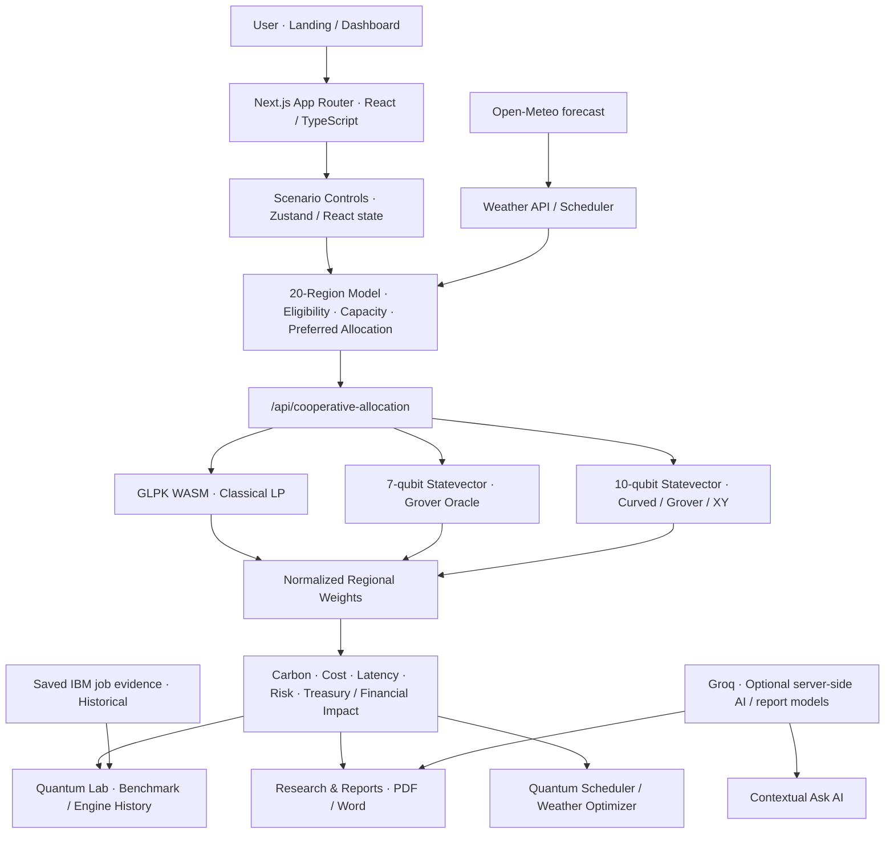
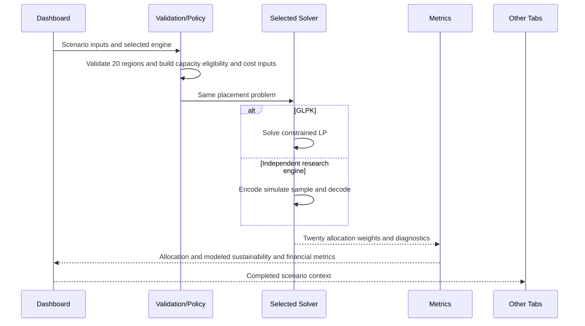
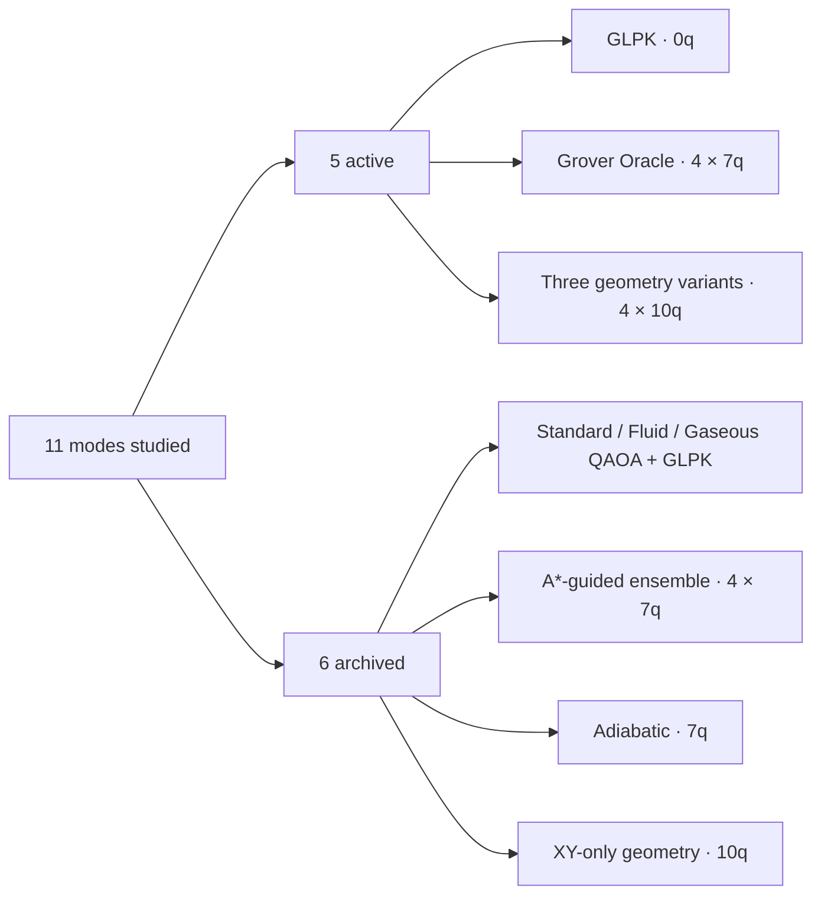
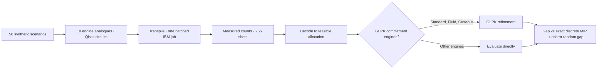
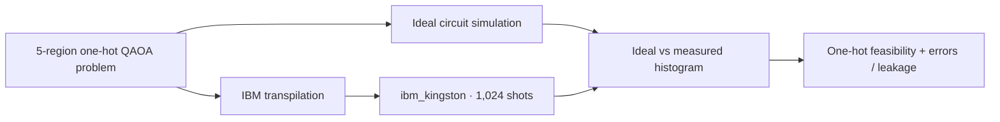
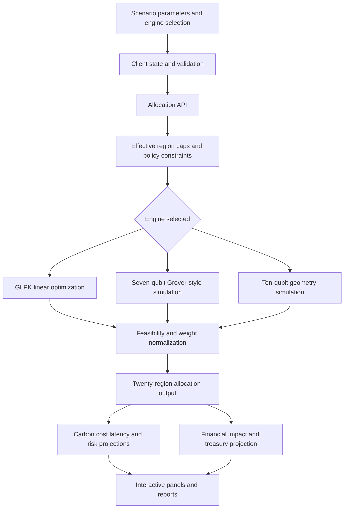
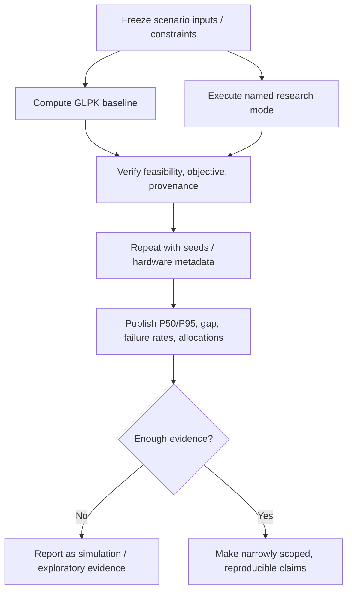

<div align="center">

# 🌍 CARBON LEDGER

### Carbon-Aware Cloud Optimization · Quantum Algorithm Research · Financial Impact

**20 regions · 11 studied engines · 5 selectable engines · CPU quantum simulation + IBM QPU benchmark (50 scenarios)**

[](https://carbon-ledger-global.vercel.app/)
[](https://nextjs.org/)
[](#the-11-engine-research-catalog)

**[🚀 Launch the website](https://carbon-ledger-global.vercel.app/)** · **[Dashboard](https://carbon-ledger-global.vercel.app/dashboard)** · **[Quantum Lab](https://carbon-ledger-global.vercel.app/quantum-lab)** · **[IBM Evidence](https://carbon-ledger-global.vercel.app/ibm-hardware)** · **[Engine History](https://carbon-ledger-global.vercel.app/history)**

</div>

> **Scientific scope:** Carbon Ledger is an interactive *decision-support and research prototype*. It simulates workload placement and its energy, cost, latency, risk and financial implications. It does **not** dispatch real cloud workloads, perform real treasury trades, or establish quantum computational advantage. Five engines are selectable; six are preserved for research history. Historical benchmark numbers are not live telemetry.

> **Evidence summary (v161):** No engine in this repository demonstrates quantum computational advantage. Every figure below comes from synthetic scenarios.
>
> - **CPU benchmark, 200 scenarios:** GLPK has the best objective and the lowest runtime. The three independent 10-qubit engines have objective gaps of about 16-17%. The Oracle's 0% gap needs an allocation-level audit because its candidate pool is prepared classically.
> - **IBM QPU study, 50 scenarios, 10 engine analogues on `ibm_kingston`:** the three engines that finish with a GLPK commitment reach 3.2-4.7% mean gap only through that classical step. The seven engines without it score 6.5-13.4%, and none is clearly better than a uniform-random baseline. See [IBM quantum hardware evidence](#ibm-quantum-hardware-evidence).
> - **Per-metric differences do not replicate across the two datasets.** See [Benchmarks and interpretation](#benchmarks-and-interpretation).

## 📚 Contents

1. [Problem, goals and scope](#problem-goals-and-scope)
2. [System architecture](#system-architecture)
3. [Features and application workflow](#features-and-application-workflow)
4. [Mathematical optimization model](#mathematical-optimization-model)
5. [The 11-engine research catalog](#the-11-engine-research-catalog)
6. [Engine mathematics and techniques](#engine-mathematics-and-techniques)
7. [Benchmarks and interpretation](#benchmarks-and-interpretation)
8. [IBM quantum hardware evidence](#ibm-quantum-hardware-evidence)
9. [Technology stack and repository map](#technology-stack-and-repository-map)
10. [Detailed implementation map](#detailed-implementation-map)
11. [APIs, environment and deployment](#apis-environment-and-deployment)
12. [Verification and reproducibility](#verification-and-reproducibility)
13. [Limits and responsible presentation](#limits-and-responsible-presentation)

---

## Problem, goals and scope

Cloud workload placement creates competing objectives: carbon intensity, cloud operating expense, response latency, eligibility/residency and available capacity. Carbon Ledger explores the trade-off through **20 modeled worldwide regions**, a common allocation problem, classical optimization, independent CPU quantum-statevector solvers, weather-adjusted scenarios, treasury modeling and historical hardware experiments.

| Input / driver | Decision mechanism | Outputs |
|:--|:--|:--|
| 20 region profiles, weather scenarios, prices, carbon and latency signals | Validated controls → feasible capacity/eligibility → chosen engine → weighted allocation → downstream calculations | Allocation weights, carbon intensity, cost, latency, modeled risk, illustrative APY, reports |

The project models regions in India, Asia Pacific, Europe, North and South America, and Africa. Region metadata lives in `lib/regions.ts`; exact units and assumptions should be checked at the point of calculation in the source.

## System architecture



**Critical separation:** IBM evidence is historical and does not mean every dashboard optimization reaches IBM hardware. The standard live frontend path is a Next.js TypeScript server/client application using GLPK WASM or CPU quantum statevector implementations. Python/Qiskit packages are optional research and external-execution components, not evidence of Python execution on each Vercel request.

### Allocation pipeline



`/api/cooperative-allocation` rejects retired modes and requires 20 regions; see `app/api/cooperative-allocation/route.ts`. Solver statuses, feasibility, latency and fallback handling must be examined per response, not inferred from UI labels.

## Features and application workflow

| Workspace | What it does | How it works / where to inspect |
|---|---|---|
| **Landing page** | Introduces the research prototype and links to workspaces | `app/page.tsx` |
| **Main dashboard** | Choose among 5 active engines; adjust workload, sustainability, budget and latency controls; inspect allocation and modeled outcomes | `app/dashboard/page.tsx`, `lib/dynamicAllocation.ts`, `lib/fractionalAllocation.ts`, allocation API |
| **Quantum Lab** | Inspect research behavior, engine diagnostics, circuits and comparative outputs | `app/quantum-lab/page.tsx`, `/api/quantum-lab-live` |
| **IBM Hardware** | Present saved IBM QPU evidence (a 50-scenario multi-engine study and an earlier 5-qubit job), the uniform-random baseline and measurement limitations | `app/ibm-hardware/page.tsx`, `lib/ibmHardwareEvidence.json`, `lib/ibmStudyData.json` |
| **Financial Impact** | Compare scenario-based cloud OPEX, offsets and modeled financial sensitivity; distinguish GLPK reference from the selected solution | `lib/financialImpact.ts`, financial components |
| **Quantum Scheduler** | Explore hourly, 24-hour placement preferences rather than execute jobs in a provider | `app/quantum-scheduler/page.tsx`, `/api/schedule`, `lib/scheduler.ts` |
| **Weather Optimizer** | Combine live weather forecast input (where available) with dashboard baseline to model weather-sensitive placement | `app/weather-optimizer/page.tsx`, `/api/weather`, `lib/weatherDashboardSync.ts` |
| **Research & Reports** | Show source-labeled study tables; generate research/financial/technical descriptions and export reports | `app/research/page.tsx`, `lib/unifiedReport.ts`, `/api/report-narrative` |
| **Engine History** | Explain archived modes, formulas, benchmark comparisons and why engines were retired | `app/history/page.tsx`, `lib/engineCatalog.ts` |
| **Ask AI** | Give tab-specific explanations using submitted current-session context | `/api/tab-assistant`, `lib/groq.ts` |
| **Autopilot / scenario tools** | Adjust scenario policy and compare outcomes with guardrails where wired into the interface | `lib/autopilot.ts`, `lib/override.ts`, `app/tools/` |
| **ONNX research controller** | Run an additional learned policy path; separate from the five-mode optimization selector | `lib/onnxInference.ts`, `/api/onnx-controller`, `public/models/` |

Some older routes remain in the repository for compatibility or research. Their presence does **not** guarantee they are exposed in primary navigation; route accessibility should be checked on deployment.

## Mathematical optimization model

For each region `i` among 20 let `w_i` be the allocated workload share, `c_i` its current aggregate weighted placement cost, `p_i` the preferred allocation, `u_i` the effective cap, and `e_i∈{0,1}` eligibility. The shared research model is:

$$
\min_{\mathbf w} E(\mathbf w) = \sum_{i=1}^{20} c_i w_i + \lambda\sum_{i=1}^{20}|w_i-p_i|
$$

subject to:

$$
\sum_i w_i=1,\quad 0\le w_i\le u_i e_i,\quad \sum_i u_i e_i\ge 1.
$$

The `c_i` scores combine policy-dependent carbon, operating price, latency and risk inputs. The `L1` deviation term discourages unnecessary redistribution. In the classical LP, introduce nonnegative `d_i` with `d_i≥w_i−p_i` and `d_i≥p_i−w_i`, then minimize `Σ c_i w_i + λΣ d_i`—a linear program. A zero gap means equality under the *chosen mathematical objective*, not necessarily identical emissions or a proven quantum speedup.

Derived metrics, when defined over regional inputs `m_i`, typically use allocation-weighted aggregation:

$$
M(\mathbf w)=\sum_i w_i m_i,\qquad
\mathrm{Gap}(\%)=100\,\frac{E(\mathbf w_{engine})-E(\mathbf w_{GLPK})}{\max(|E(\mathbf w_{GLPK})|,\varepsilon)}.
$$

The dashboard financial model is **not** a live investment market. Weighted modeled APY and estimated annual cloud OPEX are separate quantities; neither should be presented as realized savings or actual revenue. `lib/financialImpact.ts`, `lib/finance.ts` and `lib/budgetUsd.ts` contain implementation details and conversions.

## The 11-engine research catalog

**Current interface:** 5 engines; **historical archive:** 6 engines. This catalog counts benchmark modes—not 11 independently deployed IBM hardware programs.

| # | Engine | Status | Qubits / configuration | Historical gap vs GLPK | Historical runtime | Fallbacks / 200 |
|---:|---|---|---|---:|---:|---:|
| 1 | **GLPK** | Active | 0q | 0.0000% | 1.878 ms | 0 |
| 2 | **Quantum Oracle (Grover)** | Active | 7q · p=3 | 0.0000% | 3.278 ms | 0 |
| 3 | **Curvilinear Quantum Fusion** | Active | 10q · p=3 | 16.1707% | 6.943 ms | 0 |
| 4 | **Adaptive Grover 10q** | Active | 10q · p=3 | 16.1971% | 4.429 ms | 0 |
| 5 | **Geometry-Aware Quantum Walk** | Active | 10q · p=3 | 16.6644% | 4.443 ms | 0 |
| 6 | **Standard QAOA + GLPK** | Archived | QAOA research | 0.0000% | 2.068 ms | 200 |
| 7 | **Fluid XY-QAOA + GLPK** | Archived | 5q microbatches | 0.0000% | 2.331 ms | 200 |
| 8 | **Gaseous QAOA + GLPK** | Archived | QAOA research | 0.0000% | 3.026 ms | 200 |
| 9 | **A*-Guided Four-Technique Ensemble** | Archived | 4 × 7q | 19.8406% | 3.846 ms | 0 |
| 10 | **Adiabatic Quantum Engine** | Archived | 7q simulated | 270.9113% | 5.078 ms | 0 |
| 11 | **Geometry XY-Only** | Archived | 10q · p=3 | 18.4782% | 4.436 ms | 0 |

> **Benchmark provenance:** These **rounded aggregates** come from the project's catalog for a **user-reported 200-scenario synthetic comparison** dated 2026-10-23. The source was a screenshot; raw per-scenario allocations/variance/percentiles were not supplied. Do not interpret them as direct independent re-measurement, production latency, statistically rigorous rankings or hardware execution. The zero-gap Oracle record particularly requires an allocation-level audit.

### Engine family and computational structure



**Reading qubits correctly:** 4 × 7 qubits means **four independent 7-qubit registers** (128 amplitudes each), not a 28-qubit entangled machine. Likewise 4 × 10q means independent 10-qubit CPU simulations (1024 basis amplitudes per register), not 40 entangled hardware qubits. `p=3` is an algorithmic layer/repetition setting, not necessarily transpiled physical circuit depth. The archived Fluid 5q IBM microcircuit was a distinct experiment.

## Engine mathematics and techniques

The formulas in the next 11 subsections are the algorithm descriptions recorded in `lib/engineCatalog.ts`; implementation-specific selection, numerical approximations and guards live in `lib/quantumOracleEngine.ts`, `lib/geometryQuantum.ts`, `lib/quantumEngineModes.ts` and archived `research/` implementations.

### 01. GLPK — Active

**Technique:** Classical LP. **Recorded expression:** `min Σᵢ cᵢwᵢ + λΣᵢ|wᵢ − pᵢ|, subject to Σᵢwᵢ=1 and 0≤wᵢ≤capᵢ`.

GLPK provides the same-input classical baseline and solves a linear placement objective with eligibility/capacity constraints. It uses no qubits. Do not equate GLPK optimality with the optimality of every modeled sustainability and financial indicator.

**Implementation characteristics:** Simplex/interior-point LP optimization; Capacity, eligibility and deviation constraints.

**Reported research result:** mean objective gap **0.0000%**, runtime **1.878 ms**, fallback count **0/200**. 

### 02. Quantum Oracle (Grover) — Active

**Technique:** Hybrid quantum simulation. **Recorded expression:** `Oτ|z⟩ = (−1)^[E(z)≤τ]|z⟩; D=2|s⟩⟨s|−I; choose best of measured feasible allocations`.

The simulator classically forms a score-aware candidate set, prepares four independent 7-qubit registers, applies three Grover-like marking/diffusion rounds, samples states under Born probabilities and chooses a feasible decoded candidate. This is a **hybrid, CPU-simulated search**; the classical candidate creation strongly influences quality.

**Implementation characteristics:** 4 independent 7-qubit CPU statevectors; 128 candidates per register; 32 Born-rule measurements each; Classical objective-aware candidate sorting and encoding; Three Grover phase-flip/diffusion rounds.

**Reported research result:** mean objective gap **0.0000%**, runtime **3.278 ms**, fallback count **0/200**. 

### 03. Curvilinear Quantum Fusion — Active

**Technique:** Hybrid quantum simulation. **Recorded expression:** `s(t)=10t³−15t⁴+6t⁵; U≈Πₗe^(−iγₗHcost)e^(−iβₗHXY); select best measured state`.

Ten-qubit weight-five / combinatorial encodings and a quintic smooth schedule guide phase evolution; XY exchange preserves relevant subspaces. The catalog reports four persistent statevector workers with two circuit runs each. Thresholded Grover selection is additional classical/quantum-inspired filtering.

**Implementation characteristics:** 4 persistent 10-qubit statevector workers; Two depth-3 measured circuit runs per worker; Quintic curved energy schedule and XY exchange mixing; Adaptive Grover thresholds over 252 weight-five basis states.

**Reported research result:** mean objective gap **16.1707%**, runtime **6.943 ms**, fallback count **0/200**. 

### 04. Adaptive Grover 10q — Active

**Technique:** Hybrid quantum simulation. **Recorded expression:** `Oτ|z⟩=(−1)^[E(z)≤τ]|z⟩, followed by D=2|s⟩⟨s|−I (three rounds)`.

Ten-qubit masks are restricted to a 5-of-10 feasible subset (C(10,5)=252 masks), then adaptively thresholded Grover marking amplifies favorable candidates. A classical decoder maps measured masks into 20-region fractional allocations.

**Implementation characteristics:** 4 independent 10-qubit registers; 252 Hamming-weight-five feasible masks; Three rounds of adaptive Grover marking; Cost-aware allocation decoder and classical outcome selection.

**Reported research result:** mean objective gap **16.1971%**, runtime **4.429 ms**, fallback count **0/200**. 

### 05. Geometry-Aware Quantum Walk — Active

**Technique:** Hybrid quantum simulation. **Recorded expression:** `HXY = Σ(j,k)(XⱼXₖ+YⱼYₖ)/2; U(γ,β)=e^(−iβHXY)e^(−iγHcost)`.

The geometry-aware search uses phase changes from candidate energy and XY exchange across register geometry; simulated samples and their decoded allocations are scored classically. The XY dynamics preserve Hamming weight under ideal mixing.

**Implementation characteristics:** 10-qubit Dicke/Hamming-weight-five subspace; Cost-phase rotations and XY-exchange mixer; Grover marking with a nonlinear schedule; 4 worker statevector sampling.

**Reported research result:** mean objective gap **16.6644%**, runtime **4.443 ms**, fallback count **0/200**. 

### 06. Standard QAOA + GLPK — Historical

**Technique:** Quantum gate-based candidate proposal with classical GLPK refinement and quality guard. **Recorded expression:** `|ψ(γ,β)⟩ = Πₗ exp(−iβₗ Hₓ) exp(−iγₗ Hcost)|+⟩`.

An ordinary gate-model QAOA ansatz with alternating cost and X-mixer layers proposes candidates, while GLPK refinement/quality checks dominate the recorded outcome. **All 200 runs fell back to GLPK**.

**Reported research result:** mean objective gap **0.0000%**, runtime **2.068 ms**, fallback count **200/200**. 200/200 GLPK fallbacks; zero gap therefore not independent quantum achievement.

### 07. Fluid XY-QAOA + GLPK — Historical

**Technique:** 5-region one-hot microbatches, XY mixer, guarded GLPK residual refinement; separate IBM microcircuit hardware evidence. **Recorded expression:** `U = Πₗ exp(−iβₗ HXY) exp(−iγₗ Hcost), HXY=Σ(XᵢXⱼ+YᵢYⱼ)/2`.

XY exchange approximates fluid-like flow of excitation across a 5-region one-hot microbatch. This is NOT a physical hydrodynamic model. A GLPK residual step and guard were used in the archived mode. Separate 5q hardware test confirms circuit execution, not full-dashboard optimization.

**Reported research result:** mean objective gap **0.0000%**, runtime **2.331 ms**, fallback count **200/200**. 200/200 GLPK fallbacks in this run; IBM microcircuit validation does not establish full-system quantum advantage.

### 08. Gaseous QAOA + GLPK — Historical

**Technique:** X-mixer QAOA with gas-inspired classical Boltzmann reweighting and GLPK residual solve. **Recorded expression:** `Pᵢ ∝ |⟨i|ψ⟩|² exp(−κ(Eᵢ−Emin)/T)`.

QAOA/X-mixer samples are reweighted using a classical Boltzmann factor representing energy/temperature; GLPK completes or guards the allocation. “Gas” is an analogy, not a separate quantum gaseous hardware device.

**Reported research result:** mean objective gap **0.0000%**, runtime **3.026 ms**, fallback count **200/200**. 200/200 GLPK fallbacks; same solution as GLPK and slower.

### 09. A*-Guided Four-Technique Ensemble — Historical

**Technique:** Classical A* controller plus simulated Grover, quantum walks, annealing and minimum-finding heuristics; 4×7 qubits. **Recorded expression:** `f(s)=g(s)+h(s); E(w)=Σᵢcᵢwᵢ+λΣᵢ|wᵢ−pᵢ|`.

A classical A* frontier evaluation chooses promising states using f=g+h; it combines Grover-style marking, quantum-walk moves, annealing-like exploration and minimum selection in four simulated 7q registers. Hybrid search is not a theorem of faster shortest-path computation.

**Reported research result:** mean objective gap **19.8406%**, runtime **3.846 ms**, fallback count **0/200**. 19.84% gap in user 200-case run; older 1.62% came from a different benchmark formulation.

### 10. Adiabatic Quantum Engine — Historical

**Technique:** Digitized adiabatic evolution using 7-qubit statevector simulation, without GLPK solution injection. **Recorded expression:** `H(s)=(1−s)Hmix+s Hcost; |ψ(s)⟩ ≈ Πₗ e^(−iΔt H(sₗ))|ψ₀⟩`.

A discretized interpolation H(s)=(1−s)Hdriver+sHcost changes the Hamiltonian over time. Finite-step simulation samples candidate allocations. This is digitized adiabatic modeling on a CPU, not quantum annealer hardware.

**Reported research result:** mean objective gap **270.9113%**, runtime **5.078 ms**, fallback count **0/200**. Very large 270.91% objective gap in latest same-case comparison.

### 11. Geometry XY-Only — Historical

**Technique:** 10-qubit, depth-3 XY quantum walk with conserved Hamming weight. **Recorded expression:** `HXY=Σ(XᵢXⱼ+YᵢYⱼ)/2; U=Πₗe^(−iβₗHXY)e^(−iγₗHcost)`.

A 10q depth-3 XY exchange and cost-phase quantum walk explores constant-Hamming-weight encodings. This predecessor was retired after weaker gap than retained variants on the reported 200-case study.

**Reported research result:** mean objective gap **18.4782%**, runtime **4.436 ms**, fallback count **0/200**. Worse gap than retained geometry variants on 200 shared scenarios.

### Common circuit primitives (intuition)

**QAOA:** $|\psi(\boldsymbol\gamma,\boldsymbol\beta)\rangle=\prod_{l=1}^{p}e^{-i\beta_l H_M}e^{-i\gamma_lH_C}|\psi_0\rangle$; $H_C$ gives low-energy candidate phase preference, $H_M$ mixes candidates.

**XY mixer:** $H_{XY}=\tfrac12\sum_{(j,k)}(X_jX_k+Y_jY_k)$ exchanges excitations and, under the modeled arrangement, preserves Hamming weight.

**Grover operator:** $G=(2|s\rangle\langle s|-I)O_\tau$ where $O_\tau|z\rangle=(-1)^{[E(z)\le \tau]}|z\rangle$ marks favorable candidates.

**Born measurement:** $P(z)=|\langle z|\psi\rangle|^2$. A small register encoding a candidate library is not equivalent to searching all 20-region continuous allocations exhaustively.

**Adiabatic digitization:** $H(s)=(1-s)H_M+sH_C$, $U\approx\prod_l e^{-i\Delta t H(s_l)}$. Finite steps are approximations.

**Annealing-style reweighting:** $P_i\propto e^{-\kappa(E_i-E_{min})/T}|\langle i|\psi\rangle|^2$. This includes classical temperature/score weighting.

## Benchmarks and interpretation

The project preserves a screenshot-transcribed, shared-input historical benchmark with the 11 modes above. Key comparisons from that record:

| Engine | Objective gap | Runtime | Interpretable finding |
|---|---:|---:|---|
| GLPK | 0% | 1.878 ms | Reference baseline |
| Quantum Oracle | 0% | 3.278 ms | Matches rounded aggregate baseline; audit individual allocations before attributing outcome to quantum search |
| Curvilinear Fusion | 16.1707% | 6.943 ms | Independent, but less favorable objective |
| Adaptive Grover 10q | 16.1971% | 4.429 ms | Similar gap, shorter recorded runtime than curved variant |
| Geometry-aware Walk | 16.6644% | 4.443 ms | Different allocation/simulation formulation |
| Standard, Fluid, Gaseous hybrids | 0% | 2.068–3.026 ms | **200/200 GLPK fallbacks each**; no demonstrated quantum benefit |
| A*-guided ensemble | 19.8406% | 3.846 ms | Independent older candidate search |
| Adiabatic | 270.9113% | 5.078 ms | Severe objective-quality deficit |
| XY-only geometry | 18.4782% | 4.436 ms | Archived predecessor |

Different research scripts/datasets (e.g. 32-case SciPy HiGHS runs) are **not directly comparable** with this 200-case GLPK catalog. Some apparently attractive earlier gaps resulted from classical fallback or a different benchmark formulation. Runtime averages reported in the catalog are *not* reproducible guarantees on Vercel, and the screenshot summary is insufficient for P95, confidence intervals, hardware-vs-simulator comparison or robust claims of superiority.

### Cross-dataset check: do per-metric differences replicate?

The CPU benchmark above and the IBM QPU study below differ in scenarios, solvers and baselines:

| | CPU benchmark (v147) | IBM QPU study (2026) |
|---|---|---|
| Scenarios | 200 synthetic, 20 regions | 50 synthetic |
| GLPK baseline | Continuous LP | Exact MIP on a 10-bit discrete objective |
| Engines | TypeScript CPU statevector engines | Qiskit hardware-compatible analogues |
| Raw per-scenario data in repo | No (rounded, screenshot-derived means) | Yes (`public/evidence/ibm-2026/`) |
| Carbon, gCO2/kWh: GLPK | 287.50 | 280.26 |
| Adaptive Grover | 274.40 (-4.6%) | 291.40 (+4.0%) |
| Curvilinear Fusion | 274.52 (-4.5%) | 296.85 (+5.9%) |
| Geometry-aware Walk | 275.28 (-4.2%) | 299.02 (+6.7%) |

The carbon reduction in the CPU benchmark does not appear in the IBM study. There, GLPK has the lowest carbon, the lowest risk proxy and the highest treasury APY. The only metrics where an engine beat GLPK are small: Curvilinear fusion on daily operating cost and energy price (about -0.4% each) and the Gaseous hybrid on latency (about -0.5%).

Because every independent engine has an equal or worse combined objective than GLPK in both datasets, per-metric differences are best read as different points on a multi-metric trade-off, not as a quantum benefit. A GLPK weight sweep (see [Verification and reproducibility](#verification-and-reproducibility)) is the test that would settle this.

## IBM quantum hardware evidence

The repository holds two separately recorded IBM experiments. They test different circuits and must not be conflated with each other or with the live dashboard, which runs GLPK WASM or CPU statevector code.

### A. Multi-engine IBM QPU study (2026, 50 scenarios)

| Item | Recorded value |
|---|---|
| Device | `ibm_kingston` (recorded per job in `hardware_jobs.csv`) |
| IBM job ID | `dbe4m7vpc3tc739l3rvg` (one batched job) |
| Circuit records | 500 (50 scenarios x 10 engine analogues) |
| Shots | 256 |
| Depth parameter | 3 |
| Median batch wall time | 161.6 s, shared across all batched circuits (never a per-engine runtime) |
| Median transpilation wall time | 23.2 s |
| Classical baseline | GLPK exact MIP on the same 10-bit discrete objective, run on CPU |
| Engine fidelity | Qiskit hardware-compatible analogues, not direct ports of the TypeScript engines |
| Data | Synthetic scenarios, not real carbon or investment performance |



**Results (means over 50 scenarios, from `summary.csv` and `scenarios.csv`):**

| Engine (`id`) | Final gap % | Gap before GLPK commitment % | Uniform-random gap % | Scenarios better than random | Median depth | Two-qubit ops | Treasury APY % |
|---|---:|---:|---:|---:|---:|---:|---:|
| GLPK exact discrete MIP (CPU baseline) (`glpk`) | 0.00 | n/a | n/a | n/a | n/a | n/a | 6.75 |
| Standard QAOA + GLPK commitment (`standard`) | 4.73 | 15.03 | 7.52 | 54% | 288 | 54 | 6.62 |
| Fluid XY-QAOA + GLPK commitment (`fluid`) | 3.39 | 12.48 | 8.18 | 62% | 339 | 114 | 6.73 |
| Gaseous-style QAOA + GLPK commitment (`gaseous`) | 3.21 | 12.21 | 6.93 | 60% | 288 | 54 | 6.71 |
| A*-guided ensemble analogue (`quad`) | 13.39 | 13.39 | 7.63 | 30% | 339 | 114 | 6.64 |
| Grover Oracle analogue (`oracle`) | 6.51 | 6.51 | 6.80 | 44% | 6,764 | 4,400 | 6.68 |
| Digitized adiabatic search (`adiabatic`) | 12.53 | 12.53 | 8.05 | 34% | 288 | 54 | 6.58 |
| Geometry-aware cost/XY mixer (`geometry`) | 12.98 | 12.98 | 8.50 | 28% | 345 | 114 | 6.71 |
| Curvilinear XY mixer (`geometry-xy`) | 13.02 | 13.02 | 7.31 | 20% | 345 | 114 | 6.66 |
| Adaptive Grover (`geometry-grover`) | 7.97 | 7.97 | 8.26 | 46% | 10,194 | 6,666 | 6.69 |
| Curvilinear phase-walk/Grover fusion (`geometry-curved`) | 6.95 | 6.95 | 7.44 | 42% | 7,120 | 4,614 | 6.71 |

"Gap before GLPK commitment" is the measured quantum candidate gap (`measured_quantum_gap_pct`). "Uniform-random gap" is the gap of a uniform-random baseline recorded per scenario in `scenarios.csv` (`uniform_random_gap_pct`).

**Reading the results**

- **The hybrids owe their result to GLPK.** Standard, Fluid and Gaseous finish at 3.2-4.7% mean gap with a median final gap of 0.00%. Before the GLPK commitment their gaps are 12.2-15.0%, above the random baseline (6.9-8.2%). The final selection differs from the sampled candidate in 74-80% of their scenarios.
- **The other engines are close to random or worse.** Oracle, Adaptive Grover and Curvilinear fusion average 0.3-0.5 percentage points below the random baseline, and each beats it in fewer than half of the scenarios (44%, 46% and 42%). A*-guided ensemble, Adiabatic, Geometry-aware and Curvilinear XY average above the random baseline by 4-6 points.
- **The deepest circuits are the least plausible as quantum search.** Oracle, Adaptive Grover and Curvilinear fusion run at depths of roughly 6,800-10,200 with 4,400-6,700 two-qubit operations. With typical two-qubit error rates of 0.1-1%, circuits of that size are expected to be dominated by noise. Their gaps should not be read as quantum search outcomes, and the oracle step inspects the objective classically.
- **100% feasibility is not hardware fidelity.** Every engine reports 100% feasible final allocations, which reflects decoding to a feasible allocation. The ledger does not report the fraction of raw measured bitstrings that were valid.
- **Shared timing.** The 161.6 s batch wall time covers all circuits in the job, so it says nothing about any one engine's runtime.

This study is evidence about this pipeline at this scale, on one device and one batched job. It does not show that quantum optimization cannot work, and it does not show that it does.

### B. Earlier 5-qubit Fluid XY-QAOA microcircuit

Saved experiment details in `lib/ibmHardwareEvidence.json` identify a **Fluid XY-QAOA, 5-qubit microcircuit** on a five-region toy cost vector (0.18 to 0.31), not the deployed 20-region engine:

| Item | Recorded value |
|---|---|
| Device | `ibm_kingston` |
| IBM job ID | `dbc4og7i0auc73du5hbg` |
| Logical register | 5 qubits |
| Ideal model depth | 16 (logical) |
| Transpiled hardware depth | 247 |
| Two-qubit gate count | 64 |
| Shots | 1,024 |
| Valid one-hot outcomes | 788 / 1,024 |
| Observed one-hot feasibility | 76.953125% |
| Ideal one-hot feasibility in model | ~100% |



The 23.05-percentage-point difference between ideal and observed feasibility reflects the **observed valid-mask fraction** in this saved experiment; it must not be assigned solely to any single error mechanism without additional calibration and controls. Transpiled depth 247 is not the same as `p=3`. A valid IBM job documents physical circuit execution; it **does not** demonstrate end-to-end quantum speedup, full 20-region cloud deployment or superior optimization relative to GLPK.

## Technology stack and repository map

| Layer | Technology | Role |
|---|---|---|
| Web | Next.js App Router, React, TypeScript | Routed pages, SSR/API, interactive UI |
| Styling and visuals | Tailwind CSS, Framer Motion, Recharts, Three.js / React Three Fiber, D3 Sankey | Charts, interactions, animations, 3D visualizations |
| Optimization | `glpk.js` / WASM, TypeScript statevector routines | LP baseline and research solvers |
| AI | Groq (optional, server-only keys) | Ask AI and explanatory report narrative |
| Learning | ONNX Runtime Node | Separate trained controller inference |
| Research | Python, Qiskit, NumPy / scientific modules | Optional offline runs, labeling, benchmarking, hardware notebooks/scripts |
| Weather | Open-Meteo | Forecast/weather-driven scenario input |
| Deployment | Vercel + Node.js 22 | Frontend and server route hosting |

```text
Carbon-Ledger/
├── .github/
│   └── workflows/                 # GitHub workflow automation
├── app/                           # Actual Next.js App Router pages
│   ├── dashboard/              # page or subroute
│   ├── digital-twin/           # page or subroute
│   ├── history/                # page or subroute
│   ├── ibm-hardware/           # page or subroute
│   ├── quantum-lab/            # page or subroute
│   ├── quantum-scheduler/      # page or subroute
│   ├── research/               # page or subroute
│   ├── tools/                  # page or subroute
│   ├── weather-optimizer/      # page or subroute
│   └── api/                      # Server route handlers
│       ├── benchmark/route.ts
│       ├── cloud-qaoa/route.ts
│       ├── command/route.ts
│       ├── cooperative-allocation/route.ts
│       ├── explain/route.ts
│       ├── health/route.ts
│       ├── onnx-controller/route.ts
│       ├── quantum-lab-live/route.ts
│       ├── quantum-optimize/route.ts
│       ├── quantum-status/route.ts
│       ├── report-narrative/route.ts
│       ├── schedule/route.ts
│       ├── stream/route.ts
│       ├── summary/route.ts
│       ├── sweep/route.ts
│       ├── system-stats/route.ts
│       ├── tab-assistant/route.ts
│       ├── weather/route.ts
├── components/                     # React UI and data visualizations
├── lib/                            # Main TypeScript logic
│   ├── classicalWasmSolver.ts
│   ├── fractionalAllocation.ts
│   ├── dynamicAllocation.ts
│   ├── quantumOracleEngine.ts
│   ├── geometryQuantum.ts
│   ├── geometryQuantumWorker.ts
│   ├── quadQuantum.ts
│   ├── quantumEngineModes.ts
│   ├── engineCatalog.ts
│   ├── regions.ts
│   ├── scheduler.ts
│   ├── weatherDashboardSync.ts
│   ├── financialImpact.ts
│   ├── finance.ts
│   ├── groq.ts
│   ├── reportNarrative.ts
│   ├── unifiedReport.ts
│   ├── ibmHardwareEvidence.json
│   ├── ibmStudyData.json
│   ├── onnxInference.ts
│   ├── feeds/
│   ├── weather/
│   ├── quantum-v8/
│   └── lab/
├── public/
│   ├── brand/
│   ├── data/
│   ├── evidence/ibm-2026/         # IBM QPU study CSVs + metadata
│   └── models/
├── cloud_worker/                  # Optional Python worker + Dockerfiles
├── python_quantum/                # Separate quantum service experiment
├── qiskit_train/                  # Training and Qiskit scripts
├── quantum_lab/                   # Research simulations / hardware scripts
├── offline_handlers/              # Offline research hooks
├── research/                      # Archived independent solver experiments
├── scripts/                       # Benchmark, report and deployment utilities
├── tests/                         # TypeScript and Python regression tests
├── docs/                          # Technical research documentation
├── types/                         # TypeScript declarations
├── artifacts/                     # Stored experiment artifacts
├── .env.example
├── .eslintrc.json
├── .gitignore
├── .nvmrc
├── next.config.ts
├── package.json
├── package-lock.json
├── pyproject.toml
├── requirements.txt
├── tsconfig.json
├── vercel.json
└── README.md
```

## Detailed implementation map

This section maps the checked-in source tree to the run path. Names here were checked against the v161 ZIP rather than invented as conceptual placeholders. The presence of a module does not imply it runs on every request.

### Request-to-result execution stages



| Source | Why it matters | Practical verification |
|---|---|---|
| `app/api/cooperative-allocation/route.ts` | Server entry point for solver execution | Check accepted engine IDs, 20-region validation, errors, status and result payload |
| `lib/classicalWasmSolver.ts` | Classical LP baseline | Inspect constraint generation, objective and solver status |
| `lib/quantumOracleEngine.ts` | Seven-qubit Grover-like candidate search | Inspect candidate generation, statevector sampling and classical scoring |
| `lib/geometryQuantum.ts` | Geometry-based ten-qubit research routines | Check masks, Hamiltonian schedule, mixer and decoding |
| `lib/geometryQuantumWorker.ts` | Worker implementation | Check actual parallelism and fallback path, not UI-reported claims |
| `lib/quantumEngineModes.ts` | Engine mode integration | Trace mode IDs to their dedicated implementations |
| `lib/engineCatalog.ts` | Historical eleven-engine catalog | Confirm archived vs selectable modes and recorded metrics |
| `lib/dynamicAllocation.ts` | Dynamic allocation utilities | Compare user control changes with recomputed placements |
| `lib/fractionalAllocation.ts` | Fractional allocation functions | Check share bounds, normalization and policy caps |
| `lib/regions.ts` | Twenty-region scenario definitions | Confirm count, units, cap and location assumptions |
| `lib/financialImpact.ts` | Scenario financial estimates | Recalculate examples against output weights |
| `lib/scheduler.ts` | Hourly scheduling simulation | Verify hourly input and allocation evolution |
| `lib/weatherDashboardSync.ts` | Weather-to-dashboard synchronization | Verify success/error behavior when forecast source is unavailable |
| `lib/reportNarrative.ts` | Report narrative logic | Confirm AI outputs are explanations, not benchmark measurements |
| `lib/ibmHardwareEvidence.json` | Recorded 5-qubit hardware job | Validate provenance and source metadata separately from live APIs |
| `lib/ibmStudyData.json` | Aggregates behind the IBM Hardware Testing page | Recompute from `public/evidence/ibm-2026/*.csv` |
| `public/evidence/ibm-2026/` | Raw scenarios, allocations, job records, summary and metadata for the 50-scenario IBM study | Check `uniform_random_gap_pct`, `glpk_refinement` and per-job fields |
| `quantum_lab/hardware.py` | Optional CLI to prepare and submit one circuit to IBM | Needs `IBM_QUANTUM_TOKEN` locally, no hardware dependency on the website |

### Frontend pages and feature ownership

| Directory in ZIP | Ownership and intended role |
|---|---|
| `app/dashboard/` | Interactive operational scenario dashboard and engine selection |
| `app/quantum-lab/` | Quantum experimentation, circuit and solver diagnostics |
| `app/ibm-hardware/` | Saved IBM QPU evidence: the 50-scenario multi-engine study and the earlier 5-qubit job |
| `app/history/` | Historical engine catalog and research results |
| `app/research/` | Research and reports page source (check production route if receiving 404) |
| `app/weather-optimizer/` | Weather-adjusted scenario exploration |
| `app/quantum-scheduler/` | Hour-based quantum-inspired scheduling |
| `app/digital-twin/` | Retained route source; existence does not imply active navigation |
| `app/tools/` | Secondary tool routes |

### API surface reflected by repository

The ZIP contains the following `route.ts` handlers. Their public method support is intentionally not assumed: Next.js `GET` and `POST` availability depends on exports inside each file.

| Route path | Source file |
|---|---|
| `/api/benchmark` | `app/api/benchmark/route.ts` |
| `/api/cloud-qaoa` | `app/api/cloud-qaoa/route.ts` |
| `/api/command` | `app/api/command/route.ts` |
| `/api/cooperative-allocation` | `app/api/cooperative-allocation/route.ts` |
| `/api/explain` | `app/api/explain/route.ts` |
| `/api/health` | `app/api/health/route.ts` |
| `/api/onnx-controller` | `app/api/onnx-controller/route.ts` |
| `/api/quantum-lab-live` | `app/api/quantum-lab-live/route.ts` |
| `/api/quantum-optimize` | `app/api/quantum-optimize/route.ts` |
| `/api/quantum-status` | `app/api/quantum-status/route.ts` |
| `/api/report-narrative` | `app/api/report-narrative/route.ts` |
| `/api/schedule` | `app/api/schedule/route.ts` |
| `/api/stream` | `app/api/stream/route.ts` |
| `/api/summary` | `app/api/summary/route.ts` |
| `/api/sweep` | `app/api/sweep/route.ts` |
| `/api/system-stats` | `app/api/system-stats/route.ts` |
| `/api/tab-assistant` | `app/api/tab-assistant/route.ts` |
| `/api/weather` | `app/api/weather/route.ts` |

### Four distinct kinds of evidence

1. **Live interface calculation:** Next.js TypeScript route execution, WASM GLPK, and CPU statevector routines. Its elapsed time depends on the request, machine and worker warmup.
2. **Archived research benchmarks:** The engine catalog stores rounded measurements from a dated 200-scenario synthetic run. These are neither fresh hardware tests nor a live measurement of every dashboard interaction.
3. **IBM QPU multi-engine study:** 50 synthetic scenarios, 10 Qiskit engine analogues, one batched job on `ibm_kingston`, with raw CSVs in `public/evidence/ibm-2026/`. The analogues are not direct ports of the TypeScript engines, and the baseline is a discrete MIP.
4. **IBM 5-qubit microcircuit:** A separately recorded job (`dbc4og7i0auc73du5hbg`) with known shots and observed feasibility. It is not proof that the main 20-region solution runs on IBM devices.

### Qubit and state-space interpretation

| Register | Mathematical Hilbert-space size | How this maps to Carbon Ledger |
|---|---:|---|
| 5 qubits | $2^5=32$ basis states | Hardware-tested one-hot microproblem, not a 20-region quantum register |
| 7 qubits | $2^7=128$ basis states | Oracle or historical simulated candidate register |
| 10 qubits | $2^{10}=1024$ basis states | Geometry-mode CPU statevector register |
| 10 qubits, Hamming weight 5 | $\binom{10}{5}=252$ masks | Constrained geometry/Grover search subspace |
| Four 7-qubit batches | Four separate 128-state registers | Do **not** equate with one 28-qubit register |
| Four 10-qubit workers | Four separate 1024-state registers | Do **not** equate with one 40-qubit register |

The statevector memory for a complex double-precision simulation is approximately $16\times 2^q$ bytes per register before application and worker overhead. For $q=10$, the raw amplitude buffer is about 16 KiB; this does not describe all execution or deployment memory.

### Optimization correctness checklist

For a valid final allocation, verify all of the following independently of the engine label:

$$\left|\sum_{i=1}^{20}w_i-1\right|\le\epsilon$$

$$0\le w_i\le u_i e_i + \epsilon$$

$$G(w)=\frac{E(w)-E(w_{\mathrm{GLPK}})}{\max(|E(w_{\mathrm{GLPK}})|,\epsilon)}\times100\%$$

The allocation must meet capacity/eligibility, use the **same objective and inputs** for fair comparison, and disclose any repair, postprocessing or GLPK fallback. A matching rounded objective does not prove identical vectors; inspect region-by-region allocations.

**Baselines differ by experiment.** The 200-scenario CPU benchmark compares against a continuous LP solved by GLPK. The IBM QPU study compares against GLPK's exact MIP on a 10-bit discrete objective, so gaps from the two are not interchangeable. Where sampled or hardware outputs are decoded into allocations, also report a uniform-random baseline through the same decoding, as the IBM study does.

### GitHub Markdown and Mermaid compatibility

All Mermaid nodes in this README use quoted labels when labels contain punctuation. Message bodies in `sequenceDiagram` avoid semicolons because Mermaid treats semicolons as statement separators. Display equations use matching double-dollar math boundaries, and literal file paths, JSON keys and shell snippets use code fences or backticks. GitHub supports math in standard Markdown, but third-party Markdown viewers may differ. Avoid unsupported macros in display equations; use simple symbols such as `G(w)` for objective gap.

## APIs, environment and deployment

### API routes

| Endpoint | Purpose |
|---|---|
| `POST /api/cooperative-allocation` | Selected engine on validated 20-region problem |
| `/api/quantum-lab-live` | Quantum Lab live-model information |
| `/api/health` | Deployment/runtime health check |
| `/api/weather` | Weather data for forecast-aware scenarios |
| `/api/schedule` | Scheduler simulation |
| `/api/tab-assistant` | Contextual Ask AI |
| `/api/report-narrative` | Groq-supported report text |
| `/api/onnx-controller` | Optional ONNX inference path |
| `/api/benchmark` | Benchmark information |
| `/api/quantum-status` | Execution status |

Inspect route handlers for permitted HTTP methods. API routes and UI features must not be represented as externally verified until tested on the deployed website.

### Server-side configuration

Copy `.env.example` to `.env.local` for development; **never commit secrets**:

```dotenv
GROQ_API_KEY=your_assistant_groq_api_key
GROQ_API_KEY_2=optional_assistant_fallback_key
GROQ_REPORT_API_KEY=your_separate_reporting_groq_api_key
GROQ_REPORT_MODEL=openai/gpt-oss-120b
QUANTUM_MAX_CANDIDATES=32
QUANTUM_PARAMETER_GRID=8
QUANTUM_SHOTS=256
```

Assistant and report credentials can be separated, as requested by the application architecture. Provider model availability changes; verify the chosen Groq model in your Groq account. Open-Meteo integration in this project does not require a user API key. Never use `NEXT_PUBLIC_` prefixes for Groq secrets.

### Local install and checks

Requires Node.js 22 and npm. Run at repository root:

```bash
npm ci --include=optional
npm run deploy:preflight:installed
npm run typecheck
npm run lint
npm test
npm run build
npm run dev
```

Then open `http://localhost:3000`. For optional offline Qiskit/HW experimentation, consult `quantum_lab/requirements-hardware.txt`, `qiskit_train/requirements.txt` and IBM credentials documentation; this is a separate Python workflow and not required for basic Next.js hosting.

### Vercel

1. Push the project root (including `package-lock.json`, `vercel.json`, and `public/models`) to GitHub.
2. Import the repository into Vercel as **Next.js**, using Node.js 22.
3. Install with `npm ci --include=optional`; build with `npm run build`.
4. Set optional Groq environment variables in Vercel project settings, without revealing credentials in source code.
5. After a successful deployment, verify `/api/health`, each navigated tab and the full pipeline. Use `npm run deploy:smoke -- https://carbon-ledger-global.vercel.app --onnx` as a post-deploy check.

**Official application link:** **https://carbon-ledger-global.vercel.app/**

## Verification and reproducibility

A responsible benchmark should record region inputs, solver ID, version/commit, warm-up policy, random seed, CPU/hardware backend, shots, `p`, solver status, feasibility, same-objective gap, runtime distributions (P50/P95), costs, carbon and allocations. Archive raw per-run results separately and report whether fallback was invoked.



Useful source checks include `npm run verify:deploy`, `npm run benchmark:curved:glpk`, `npm run test:engines:v149` and `npm run experiment:20regions`. A generated benchmark is only trustworthy if scripts finish successfully and their raw data is retained. This README was produced through repository inspection; **a full dependency install, production build, live site check and IBM job API revalidation were not performed for this documentation update**.

### Evidence already in the repository

The IBM QPU study ships its raw data, so every figure in the IBM section can be re-derived:

| File | Contents |
|---|---|
| `public/evidence/ibm-2026/scenarios.csv` | 550 rows (50 scenarios x 11 engines): gaps, feasibility, carbon, cost, latency, risk proxy, APY, uniform-random gap |
| `public/evidence/ibm-2026/allocations.csv` | 11,000 rows: per-region allocation against GLPK for each scenario and engine |
| `public/evidence/ibm-2026/hardware_jobs.csv` | 500 job records: backend, job ID, batch and transpilation wall time, depth, two-qubit operations, samples observed |
| `public/evidence/ibm-2026/summary.csv` | Per-engine means used by the IBM Hardware Testing page |
| `public/evidence/ibm-2026/metadata.json` | Shots, scenarios, depth, job ID, baseline definition and warnings |

### Recommended additional controls (not yet run)

1. **Cross-check GLPK** against a second solver such as HiGHS on the same scenarios, and log solver status, feasibility and constraint satisfaction per scenario.
2. **GLPK weight and lambda sweep** on the same inputs, to place each engine's carbon, price and deviation on GLPK's own trade-off curve.
3. **Allocation-level audit of the Quantum Oracle,** with and without the classically pre-sorted candidate pool.
4. **Ideal vs noisy-simulator vs hardware comparison** for the engine that ships in the dashboard, including the fraction of raw measured bitstrings that are valid.
5. **Rerun the 200-scenario benchmark** with raw per-scenario allocations, seeds, fallback flags and P50/P95 runtimes saved.

## Limits and responsible presentation

- **No quantum advantage is demonstrated.** In the IBM QPU study the engines without GLPK commitment are not clearly better than a uniform-random baseline, and the engines with it owe their result to the classical step.
- **The IBM study uses analogues and a discrete baseline.** Its circuits are Qiskit analogues of the dashboard engines, and its baseline is GLPK's exact MIP on a 10-bit discrete objective, not the continuous LP.
- **Deep circuits are not credible quantum search.** Circuits with thousands of two-qubit operations are expected to be noise-dominated on current devices.
- **Per-metric wins do not replicate.** Lower carbon in the CPU benchmark is absent in the IBM study, so such differences are not evidence of quantum benefit.
- **Hybrid ≠ hardware advantage:** CPU quantum statevector simulation plus classical scoring/selection is valid algorithm research, but not a demonstration of fault-tolerant quantum computation or faster-than-classical behavior.
- **Fair comparisons matter:** Same scenario, effective objective, constraints and computational environment are prerequisites for credible gaps and timing statements.
- **GLPK fallbacks are disclosed:** The historical Standard, Fluid and Gaseous QAOA hybrids matched GLPK after fallback in all 200 recorded cases.
- **Research evidence is dated:** A saved IBM job and a curated screenshot-derived benchmark are not live measurements or proof of the website's current state.
- **Data are modeled:** Carbon, cloud spending, SLA, treasury APY and financial impact are scenario estimates, not verified production data or investment advice.
- **Security:** Protect Groq and IBM credentials, rate-limit costly generation routes before wide public deployment, and do not commit `.env.local` or private experimental data.

---

<div align="center">

### One dashboard · 20 regions · transparent classical and quantum research

**[Open Carbon Ledger Global](https://carbon-ledger-global.vercel.app/)**

Documentation reflects the Carbon Ledger v161 IBM-Hardware GitHub-ready snapshot, including the 50-scenario IBM QPU study, with explicit caveats where research evidence is incomplete.

</div>
